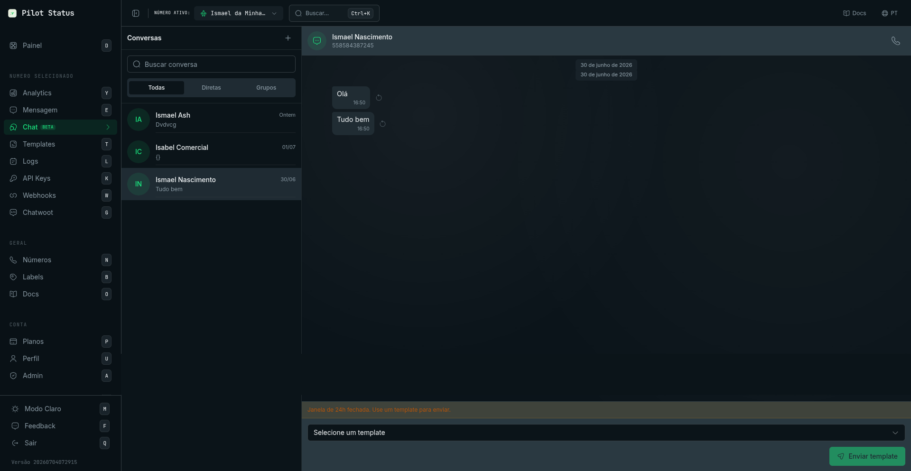
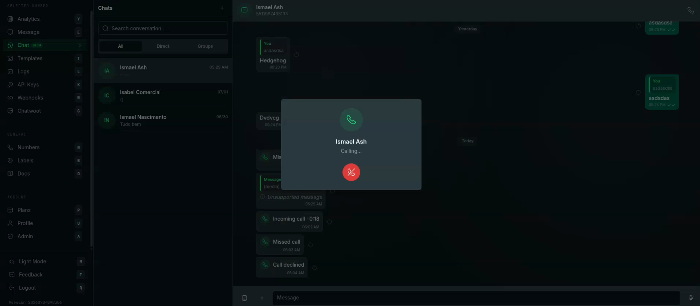

A tela **Chat** é uma caixa de entrada do WhatsApp dentro do painel. Você lê e responde as conversas de um número de WhatsApp por vez — conversas diretas, grupos e canais — de qualquer navegador, enquanto a sua integração pela API continua rodando no mesmo número.

<Frame caption="A caixa de entrada do Chat — lista de conversas, thread de mensagens e a composição de template exibida quando a janela de 24 horas está fechada.">
  
</Frame>

## Como chegar

Menu lateral → **Chat** (marcado como beta), ou direto em `/chat` (atalho **C**). Cada conversa tem a sua própria URL, `/chat/<conversationId>`: abrir (ou recarregar) essa URL abre a conversa direto, mesmo quando ela não está na primeira página da lista.

A tela sempre trabalha sobre o **Número ativo** escolhido no topo do painel. Troque o número no topo para ver a caixa de entrada de outro número; cada número tem as suas próprias conversas, e a conversa aberta fecha quando você troca.

- **Nenhum número conectado:** a tela fica bloqueada com **"Conecte um número para continuar"** e o botão **Adicionar Número**.
- **Nenhum número selecionado:** aparece **"Selecione um número"** — _"Escolha um número de WhatsApp para ver e responder as conversas."_
- **Número de teste compartilhado selecionado** (o número **Teste**): você pode navegar, mas todo envio, chamada e encaminhamento é recusado com _"Número de teste: selecione um número seu para enviar no chat."_

A mesma tela também pode ser incorporada no seu produto — veja [Chat incorporado](/pt-BR/integrations/embed-chat).

<Note>
  O Chat é um recurso dos planos pagos: a página de [Planos](/pt-BR/plans) o lista como não incluído no **Free**.
</Note>

## Quem pode usar

| Papel | O que tem |
| --- | --- |
| **Proprietário**, **Administrador** | Tudo nesta tela. |
| **Atendente** | Tudo nesta tela, mas só nos números aos quais o administrador deu acesso (veja [Membros](/pt-BR/dashboard/members)). |
| **Analista** | **Sem acesso.** O Analista não tem a permissão de chat — ler as conversas dos clientes é justamente o que esse papel existe para não alcançar. O item **Chat** não aparece para ele. |

Ler conversas exige a permissão de chat; enviar, reagir, encaminhar, fixar, favoritar, apagar, tentar de novo e organizar conversas (arquivar, fixar, limpar, apagar) exigem a permissão de envio; iniciar uma nova conversa exige a permissão de contatos; chamadas exigem a permissão de chamadas. Proprietário, Administrador e Atendente têm as quatro.

## O que aparece depende do número

A tela esconde o que a conexão do número não consegue fazer:

| | Número oficial (Meta Cloud API) | Número não oficial (Evolution GO) | Número não oficial (Evolution v2) |
| --- | --- | --- | --- |
| Texto, mídia, áudios, templates, mensagens de lista, figurinhas | Sim | Sim | Sim |
| Filtros **Grupos** e **Newsletter** | Não | Sim | Sim |
| Presença "digitando" / "gravando" mostrada ao contato | Não | Sim | Sim |
| **Ligar** (softphone) | Sim | Sim | Não |
| Janela de 24 horas para mensagens livres | **Sim** | Não | Não |

## A lista de conversas (painel da esquerda)

O cabeçalho mostra **Conversas**, com o botão **Nova conversa** (**+**).

- **Buscar conversa** — filtra a lista por nome ou número.
- **Filtros** — **Todas**, **Não lidas**, **Favoritas**, **Diretas**, **Grupos**, **Newsletter**. Cada filtro, menos **Todas**, mostra quantas conversas não lidas tem. **Grupos** e **Newsletter** só aparecem em números não oficiais. Os filtros que não cabem ficam em **Mais filtros**.
- **Arquivadas** — uma linha no topo da lista **Todas** quando há conversas arquivadas. Abre uma visão própria (**Arquivadas**, com seta de voltar): _"Estas conversas continuam arquivadas quando novas mensagens são recebidas."_
- **Cada linha** mostra a foto, o nome (ou o número), a prévia da última mensagem, o horário, o contador de não lidas (**99+** acima de 99) e um ícone para as conversas fixadas. Um grupo sem nome aparece como **Grupo sem nome** / **Grupo #id**; um canal, como **Canal** / **Canal #id**.
- **Mais opções** numa linha (ao passar o mouse no computador, segurando no celular): **Fixar conversa** / **Desafixar conversa**, **Arquivar conversa** / **Desarquivar conversa**, **Adicionar às favoritas** / **Remover das favoritas**, **Marcar como lida** / **Marcar como não lida**.

Regras por trás dessas ações:

- Você pode fixar no máximo **3** conversas por número. Fixar uma conversa arquivada a desarquiva; arquivar uma conversa fixada a desafixa.
- **As favoritas são pessoais**: cada usuário tem as suas, e elas nunca aparecem para um colega. Arquivada, fixada e não lida valem para todo o workspace.
- Abrir uma conversa a marca como lida.

Estados vazios: **Nenhuma conversa ainda.**, **Nenhuma conversa não lida.**, **Nenhuma conversa arquivada.** e, em **Favoritas**, _"Nenhuma conversa favorita. Adicione pelo menu da conversa."_

## Iniciar uma conversa — painel "Nova conversa"

Clique em **+** (**Nova conversa**). O painel da esquerda vira o painel **Nova conversa**:

- **Buscar nome ou número** — busca nos seus contatos (**Nenhum contato encontrado.** quando nada bate). Clique num contato para abrir a conversa.
- **Iniciar por número** — abre um teclado: **Escolher o código do país**, o campo **Número de telefone**, **Apagar** e **Iniciar conversa**. O Pilot Status abre a conversa que já existe com esse número, ou a cria.

Num número oficial, uma conversa nova começa com a janela de 24 horas fechada, então a primeira mensagem precisa ser um template.

## A conversa (painel da direita)

Clique numa conversa para abri-la. O cabeçalho mostra a foto, o nome e, abaixo, o número de telefone, **Grupo**, **Newsletter** ou **Conta comercial** (contatos do WhatsApp Business). Botões do cabeçalho:

- **Pesquisar mensagens** — o painel de busca: **Pesquisar nesta conversa** e **Ir para uma data** (vai até a primeira mensagem daquele dia). **Nenhuma mensagem encontrada** quando nada bate.
- **Ligar** — só em conversas diretas, em números que fazem chamadas (veja [Chamadas](#chamadas-softphone)).
- **Mais opções** (**⋮**) — o menu da conversa, veja abaixo.
- Clicar no nome abre **Dados do contato** / **Dados do grupo**.

As mensagens que você enviou ficam à direita; as recebidas, à esquerda. Em cada mensagem enviada:

| Indicador | Significado |
| --- | --- |
| Relógio | **Enviando** — na fila, ainda não aceita pelo WhatsApp. |
| ✓ | **Enviada** |
| ✓✓ | **Entregue** |
| ✓✓ azul | **Lida** |
| **!** vermelho | **Falhou** — com **Não enviada —** e o motivo dado pelo WhatsApp, e o botão **Tentar novamente**. |

Outras marcas: o selo **App** (_"Enviado pelo app"_) nas mensagens enviadas pelo próprio celular, uma estrela nas mensagens que você favoritou, um ícone nas mensagens fixadas, os rótulos **Encaminhada** / **Encaminhada com frequência**, as reações abaixo do balão e os balões de chamada (**Chamada recebida**, **Chamada realizada**, **Chamada perdida**, **Chamada não atendida**, **Chamada recusada**, **Chamada falhou**).

Avisos e selos que podem aparecer:

- **Veio de um anúncio** / **Veio de uma publicação** numa mensagem que chegou de um anúncio de clique para o WhatsApp, com **Ver desempenho**.
- **Veio do formulário &lt;formulário&gt;** quando o contato veio de um formulário de leads da Meta.
- _"As mensagens não são armazenadas para este número (modo somente-encaminhamento)."_ — o modo de privacidade do número não guarda histórico, então a caixa de entrada fica vazia.
- **conteúdo indisponível** no lugar de um nome ou de uma mensagem quando a configuração de privacidade do número os oculta.
- **Mídia indisponível** — _"A mensagem chegou, mas o arquivo não foi guardado — não há o que baixar."_; **Carregando mídia…** enquanto o arquivo ainda está sendo processado.

Se a conversa não carregar, aparece **Não foi possível carregar as mensagens.** com **Tentar novamente**.

### Ações da mensagem

Clique com o botão direito numa mensagem (computador) ou segure-a (celular):

| Ação | O que faz |
| --- | --- |
| **Dados da mensagem** | Abre o diálogo **Dados da mensagem** (veja abaixo). |
| **Responder** | Cita a mensagem no compositor (**Respondendo** … **Cancelar resposta**). No celular, você também pode arrastar a mensagem para o lado. |
| **Copiar** | Copia o texto. |
| **Encaminhar** | Abre o diálogo **Encaminhar mensagem**. Fica desabilitado, com _"Esta mensagem não pode ser encaminhada"_, para localizações, cartões de contato, chamadas, mensagens apagadas e mídias cujo arquivo não existe mais. |
| **Fixar** / **Desafixar** | Fixa a mensagem para todo o workspace. Em números Evolution GO a fixação também é aplicada no WhatsApp; nos outros, ela existe só no Pilot Status. |
| **Favoritar** / **Desfavoritar** | Coloca a mensagem nas suas **Mensagens favoritas**. As mensagens favoritas são pessoais. |
| **Selecionar mensagens** | Entra na seleção múltipla (veja abaixo). |
| **Apagar** | Apaga a mensagem **só no Pilot Status** (_"Mensagem apagada."_). Ela **não** é apagada no WhatsApp do contato. |

**Reagir:** passe o mouse sobre a mensagem e escolha 👍 ❤️ 😂 😮 😢 🙏, ou **Mais reações**. Escolha o mesmo emoji de novo (ou clique na sua reação) para tirá-la. As reações só aparecem em conversas diretas e, em números oficiais, só nas mensagens que o contato enviou.

**Selecionar mensagens** (também no menu **⋮**) troca o compositor por uma barra: **Mensagens selecionadas**, **Favoritar**, **Copiar**, **Encaminhar** e **Cancelar**.

<Note>
  Não confunda as duas "favoritas": **Favoritar** uma *mensagem* a coloca em **Mensagens favoritas**; **Adicionar às favoritas** uma *conversa* a coloca no filtro **Favoritas** da lista. As duas são pessoais.
</Note>

### Diálogo "Dados da mensagem"

| Numa mensagem que você enviou | Numa mensagem que você recebeu |
| --- | --- |
| Horários de **Enviada**, **Entregue** e **Lida**. | **De** (em grupos), **Tipo**, **Recebida**, **ID da mensagem**, **Arquivo**, **Tipo de mídia**. |

O **ID da mensagem** é o id que o WhatsApp deu à mensagem (o `wamid` em números oficiais). É o mesmo id que a API e os webhooks usam para essa mensagem.

### Diálogo "Encaminhar mensagem"

Título **Encaminhar mensagem** (ou **Encaminhar N mensagens**, a partir de **Selecionar mensagens**). _"A mensagem é reenviada como uma nova mensagem para cada conversa escolhida."_ Busque com **Buscar por nome ou telefone**, marque até **5** conversas (**Escolha até 5 conversas**, depois **Limite de 5 conversas atingido**) e clique em **Encaminhar**. As conversas que falharam aparecem em **Não encaminhada para:**. Encaminhar não está disponível no número de teste.

### Diálogo de contato compartilhado

Um cartão de contato recebido mostra **Conversar** (abre uma conversa com aquele número) e **Ver contato** (ou **Ver todos**, quando são vários). O diálogo, **Contato compartilhado** / **Contatos compartilhados** — _"Recebido nesta conversa como cartão de contato."_ — lista cada nome, empresa, telefone (**Copiar telefone**, **Conversar**) e e-mail (**Copiar e-mail**).

### Visualizador de mídia

Clique numa imagem ou num vídeo para abrir em tela cheia. Você navega com **Anterior** / **Próximo**, usa **Ampliar** / **Diminuir zoom** e tem **Responder**, **Reagir**, **Favoritar**, **Encaminhar**, **Baixar** e **Ir para a mensagem**.

### Mensagens favoritas

**Mensagens favoritas** (no menu **⋮** ou no painel de dados) lista as mensagens que você favoritou nesta conversa, com **Carregar mais**. Clique numa delas para ir até ela.

## O compositor

- Campo **Mensagem** — **Enter** envia. O rascunho fica guardado por conversa, mesmo depois de você fechar a conversa.
- **Enviar template** — muda para o compositor de template (opcional, exceto quando a janela de 24 horas está fechada).
- **Anexar** (**+**) — **Documento**, **Fotos e vídeos**, **Câmera**, **Lista** e **Figurinha**. Você também pode colar arquivos ou arrastá-los sobre a conversa (_"Solte para anexar à conversa"_).
- **Gravar áudio** (aparece quando o campo está vazio) — a barra de gravação tem **Cancelar gravação**, **Pausar** / **Continuar** e **Enviar áudio**.

### Prévia da mídia

Fotos, vídeos, documentos e figurinhas que você anexa — pelo **Anexar**, colando ou arrastando sobre a conversa — são enviados ao servidor primeiro e depois aparecem numa prévia, antes de qualquer envio ao contato. Um documento aparece como um ícone de arquivo com o nome dele. A prévia tem **Adicione uma legenda...** (escondida para figurinhas), **Emoji**, uma faixa de miniaturas para alternar entre os arquivos e **Enviar**. **Fechar** (ou **Esc**) cancela.

- A legenda vai só com o **primeiro** arquivo. Os outros arquivos saem logo depois, um por um, sem legenda.
- Não há controle de corte nem de qualidade: o que você envia é o arquivo exatamente como foi escolhido, no tamanho e na qualidade originais. Para cortar ou redimensionar uma imagem, faça isso antes de anexá-la.
- Para incluir arquivos no mesmo envio, arraste-os sobre a prévia enquanto ela está aberta: eles entram nela. A faixa de miniaturas não tem botão **+**.
- Os arquivos são conferidos no upload: imagens (PNG, JPEG, WebP, GIF) até **10 MB**, vídeos (MP4, WebM, MOV, 3GP) até **64 MB**, documentos (PDF, Word, Excel, PowerPoint, TXT, CSV, ZIP) até **100 MB**. Um arquivo de outro tipo ou acima do limite não é anexado, e aparece **Falha ao enviar mídia.**
- A figurinha precisa ser uma imagem `.webp` de exatamente **512×512 pixels**. Qualquer outro tamanho é recusado antes do upload com _"A figurinha precisa ter exatamente 512x512 pixels — esta tem &lt;largura&gt;x&lt;altura&gt;. Redimensione e tente de novo."_

### Mensagem de lista

**Anexar → Lista** abre **Mensagem de lista**: **Texto da mensagem**, **Texto do botão** (ex.: _Ver opções_), depois seções com **Título da seção (opcional)** e linhas com **Título da linha**, **Descrição (opcional)** e **ID da linha (opcional)**. Use **Adicionar seção** / **Adicionar linha** e clique em **Enviar lista**.

### Templates e a janela de 24 horas

Num **número oficial (Meta)** você só envia mensagens livres (texto, mídia, listas, áudios) até **24 horas** depois da última mensagem do contato. Fora disso, o compositor mostra _"Janela de 24h fechada. Use um template para enviar."_ e vira o compositor de template, que não pode ser cancelado até o contato escrever de novo.

No compositor de template: **Selecione um template** (os templates aprovados do número; **Nenhum template aprovado.** quando não há nenhum), preencha cada variável (**Valor**), confira a **Prévia** e clique em **Enviar template**. Se o envio não puder ser confirmado, aparece _"Não foi possível confirmar o envio do template. Tente novamente — ele não será enviado em dobro."_ com **Tentar novamente**.

Números não oficiais não têm janela de 24 horas: **Enviar template** é só um atalho.

O compositor vira um aviso em dois casos: **Somente admins podem enviar mensagens** (um grupo de avisos em que o seu número não é admin) e **Você não pode enviar mensagens neste canal** (um canal em que o seu número não pode publicar).

## Chamadas (softphone)

Em conversas diretas de números **oficiais (Meta)** e **Evolution GO**, **Ligar** no cabeçalho (ou no painel de dados) faz uma chamada de voz do WhatsApp pelo navegador. As chamadas recebidas tocam na tela aberta.

<Frame caption="Chamadas de voz no /chat — o softphone integrado toca ali mesmo, e eventos de chamada (recebida, perdida, recusada) aparecem como bolhas na conversa.">
  
</Frame>

O painel da chamada mostra o contato e o estado — **Chamada recebida…** (**Atender**, **Recusar**), **Chamando…**, **Conectando…**, o tempo da chamada (**Silenciar** / **Ativar microfone**, **Desligar**), **Chamada encerrada** ou **Falha na chamada** (**Fechar**). Motivos de falha que ele pode mostrar:

- _"Permita o acesso ao microfone para ligar."_
- _"Este navegador não suporta chamadas."_
- _"O contato ainda não autorizou receber chamadas. Peça permissão pela conversa."_ (números oficiais)
- _"Chamadas não estão habilitadas para este número."_ (números oficiais)
- _"A conta WhatsApp Business (WABA) não tem método de pagamento. Chamadas do negócio são cobradas pela Meta — adicione um cartão no WhatsApp Manager."_

Veja a [visão geral de chamadas](/pt-BR/api/calls/overview) para entender como as chamadas funcionam e como habilitá-las.

## Menu da conversa (⋮)

| Item | O que faz |
| --- | --- |
| **Dados do contato** / **Dados do grupo** | Abre o painel de dados. |
| **Buscar** | Abre a busca de mensagens. |
| **Mensagens favoritas** | As suas mensagens favoritas nesta conversa. |
| **Selecionar mensagens** | Seleção múltipla. |
| **Exportar conversa** → **Texto (.txt)** / **Planilha (CSV)** | Baixa a conversa (_"Conversa exportada"_). |
| **Arquivar** / **Desarquivar** | Move a conversa para **Arquivadas** ou de volta. |
| **Fixar** / **Desafixar** | Fixa a conversa no topo da lista (no máximo 3). |
| **Adicionar às favoritas** / **Remover das favoritas** | O seu filtro pessoal **Favoritas**. |
| **Marcar como não lida** | Volta a marcar a conversa como não lida. |
| **Fechar conversa** | Fecha a conversa (o mesmo que **Esc**). |
| **Limpar conversa** | Pergunta **Limpar esta conversa?** antes. |
| **Apagar conversa** | Pergunta **Apagar esta conversa?** antes. |

### Limpar esta conversa? / Apagar esta conversa?

- **Limpar conversa** — _"As mensagens até agora deixam de aparecer aqui. A conversa continua na lista."_ A conversa, a lista de mídias, a busca e a exportação passam a começar a partir desse momento. Nada é apagado.
- **Apagar conversa** — _"A conversa sai da lista até chegar uma nova mensagem."_ As mensagens continuam guardadas.

Os botões são **Cancelar** e **Limpar conversa** / **Apagar conversa**. Nenhum dos dois mexe no WhatsApp do contato.

## Painel "Dados do contato" / "Dados do grupo"

Abre à direita (em tela cheia no celular). Mostra a foto, o nome e o número — ou, num grupo, **Grupo · N membros** — e mais:

- Botões **Ligar** e **Buscar**.
- **Descrição** (grupos).
- **Mídia, links e docs** — abre o navegador de mídias com as abas **Mídia**, **Links** e **Docs** e **Carregar mais**. Clique num item para abri-lo ou ir até a mensagem. _"As mídias não são armazenadas para este número."_ em números no modo somente-encaminhamento.
- **Mensagens favoritas** — as suas mensagens favoritas nesta conversa.
- Membros do grupo — cada membro, com o selo **Admin** quando for o caso, **Ver todos (N)**, **Buscar membro por nome ou número**, **Mostrar mais** e **Conversar com &lt;telefone&gt;** para abrir uma conversa direta com um membro. _"Não foi possível carregar os participantes agora."_ se a lista de membros falhar.
- **Arquivar conversa**, **Fixar conversa**, **Marcar como não lida**, **Exportar conversa** (**Texto (.txt)** / **Planilha (CSV)**), **Limpar conversa** e **Apagar conversa** — as mesmas ações do menu **⋮**.

## Valores desta tela

Nada nesta tela é mostrado uma vez só. Todo valor pode ser aberto de novo a qualquer momento:

- **ID da mensagem** de uma mensagem recebida: **Dados da mensagem**.
- Horários de entrega de uma mensagem enviada: **Dados da mensagem**.
- O número do contato: o cabeçalho da conversa ou o painel de dados.
- Arquivos: **Baixar** no visualizador de mídia, ou **Mídia, links e docs**.

## Pela API / MCP

As chamadas à API usam uma chave de API vinculada ao número; as ferramentas MCP encapsulam os mesmos endpoints.

| Ação no painel | API | Ferramenta MCP |
| --- | --- | --- |
| Lista de conversas | [`GET /v1/conversations`](/pt-BR/api/conversations) | `conversations_list` |
| Ler uma conversa | [`GET /v1/messages/history`](/pt-BR/api/messages/history) | `messages_history` |
| Ler mensagens de grupo | [`GET /v1/messages/group`](/pt-BR/api/messages/group-messages) | `messages_group` |
| Mensagens não lidas / contagem de não lidas | [`GET /v1/messages/unread`](/pt-BR/api/messages/unread), `GET /v1/messages/unread/counts` | `messages_unread`, `messages_unread_counts` |
| Marcar como lida | [`POST /v1/messages/read`](/pt-BR/api/messages/read) | `messages_mark_read` |
| Indicador de digitação | [`POST /v1/messages/typing`](/pt-BR/api/messages/typing) | `messages_typing` |
| Enviar texto, mídia, áudio, figurinha, lista ou template; nova conversa com um número | [`POST /v1/messages/send`](/pt-BR/api/messages/send) — veja [texto](/pt-BR/api/messages/send-text), [mídia](/pt-BR/api/messages/send-media), [interativas](/pt-BR/api/messages/send-interactive) | `messages_send` |
| Dados da mensagem (status, horários) | [`GET /v1/messages/{id}`](/pt-BR/api/messages/status) | `message_get` |
| Tentar novamente numa mensagem que falhou | [`POST /v1/messages/{id}/resend`](/pt-BR/api/messages/resend) | — (API ou painel) |
| Baixar um arquivo recebido (números oficiais) | [`GET /v1/media/{mediaId}`](/pt-BR/api/media-download) | `media_get` |
| Ligar, atender, recusar, desligar | [`/v1/calls`](/pt-BR/api/calls/endpoints) | `call_initiate`, `call_accept`, `call_reject`, `call_terminate` |
| Dados e membros do grupo | [`GET /v1/groups/{groupId}`](/pt-BR/api/groups) | `group_info`, `groups_list` |
| Canais | [`GET /v1/newsletters`](/pt-BR/api/newsletters) | `newsletters_list` |
| Responder (citar), reagir, encaminhar | — | **Só no painel** |
| Favoritar, fixar ou apagar uma mensagem | — | **Só no painel** (fixar mensagem em grupo: `POST /v1/groups/{groupId}/pin`, `group_pin`) |
| Arquivar, fixar, favoritar, marcar como não lida, limpar, apagar ou exportar uma conversa | — | **Só no painel** |

Relacionados: [Eventos de webhook](/pt-BR/api/webhooks/events) (receba as mesmas mensagens em tempo real) · [Chatwoot](/pt-BR/integrations/chatwoot) (responda pelo Chatwoot).
