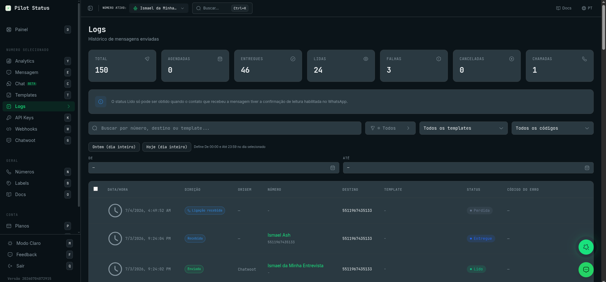
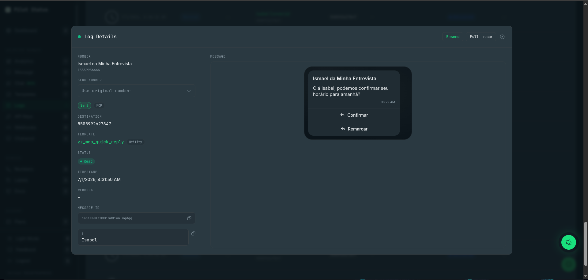
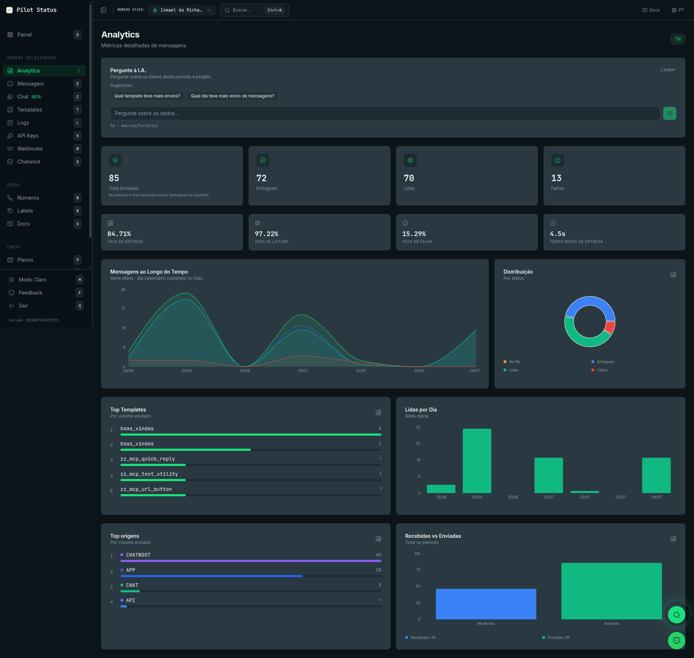

O Pilot Status registra cada mensagem que passa pelos seus números e mostra esses dados em duas telas: **Logs**, um histórico pesquisável de mensagens e chamadas individuais, e **Analytics**, métricas agregadas de um período. As duas telas mostram o número escolhido no seletor de número do cabeçalho, não o workspace inteiro.

## Logs

**Logs** (`/logs`) é onde você confere o que aconteceu com uma mensagem específica: se foi entregue, por que falhou, o que exatamente foi enviado e para quem. Daqui você também reenvia mensagens com falha e cancela envios agendados.

Abra pela barra lateral: **Logs**, no grupo **Numero selecionado** (atalho de teclado: `L`). O título da página é **Logs**, com o subtítulo **Histórico de mensagens enviadas**.

<Frame caption="A página de Logs — cards de estatísticas (total, agendadas, entregues, lidas, falhas, canceladas, chamadas), filtros e a tabela de mensagens.">
  
</Frame>

### Quem pode fazer o quê

| Ação | Owner | Admin | Agent | Analyst |
| --- | --- | --- | --- | --- |
| Abrir **Logs**, filtrar, abrir **Detalhes do Log** | Sim | Sim | Sim | Não |
| **Cancelar agendamento(s)** | Sim | Sim | Sim | Não |
| **Reenviar**, **Reenviar mensagen(s)**, escolher um **Número de envio** | Sim | Sim | Não | Não |

As permissões por trás: `logs:read:content` abre a tela, `messages:cancel_scheduled` cancela envios agendados e `messages:resend` reenvia. O Analyst não abre Logs porque cada linha traz o conteúdo da mensagem e o telefone do contato. Um membro restrito a alguns números vê só esses números. Veja [Papéis e permissões](/pt-BR/concepts/roles-and-permissions).

### Cards de estatísticas

Sete cards ficam no topo da página:

| Card | O que conta |
| --- | --- |
| **Total** | Todos os registros que batem com a busca e os filtros de status, template e período, no servidor. Mostra `…` enquanto a contagem ainda carrega. |
| **Agendadas** | Mensagens ainda esperando um horário de envio futuro. |
| **Entregues** | Mensagens com status Enviado, Entregue, Lido ou Ouvida. |
| **Lidas** | Mensagens com status Lido ou Ouvida. |
| **Falhas** | Mensagens com status Falha. |
| **Canceladas** | Mensagens cujo envio agendado foi cancelado. |
| **Chamadas** | Registros de chamada (as chamadas não entram nos cards de mensagem). |

<Note>
  Só o **Total** é contado no servidor. Os outros seis cards contam as linhas já carregadas na tela (50 por página), não o histórico inteiro. Para incluir linhas mais antigas, clique em **Ver mais logs** no fim da tabela ou estreite o período. Os cards seguem os filtros de busca, status, template e período, mas não os de direção, origem, janela e código de erro, que só escondem linhas na tabela.
</Note>

Abaixo dos cards, um aviso lembra que o status **Lido** só chega quando o destinatário tem a confirmação de leitura ligada no WhatsApp.

O botão **Atualizar**, no canto superior direito, recarrega a lista. A lista também se atualiza sozinha a cada poucos segundos enquanto você está nas primeiras páginas.

### Busca e filtros

A caixa de busca (**Buscar por número, destino ou template...**) aceita número de telefone em qualquer formato (`+55 (11) 99999-9999` funciona) ou nome de template.

A barra de filtros tem:

| Filtro | Opções |
| --- | --- |
| Status | **Todos**, **Agendada**, **Na fila**, **Enviado**, **Entregue**, **Lido**, **Ouvida**, **Falha**, **Cancelada**, **Prévia**, **Chamadas** |
| Direção | **Todas**, **Enviadas**, **Recebidas** |
| **Origem** | **Todas**, **API**, **MCP**, **Chat**, **Chatwoot**, **Painel**, **Sistema**, **App**, **Camada Meta** |
| **Janela** | **Todas**, **Aberta**, **Fechada** — a janela de atendimento de 24h no momento do envio |
| **Filtrar por template** | **Todos os templates** ou um template |
| **Filtrar por código de erro** | **Todos os códigos**, **Com erro (qualquer)** ou um código da lista de [Códigos de erro dos logs](/pt-BR/api/messages/log-error-codes) |
| Período | **De** e **Até**, cada um com data, **Hora** e **Minuto**. **Ontem (dia inteiro)** e **Hoje (dia inteiro)** preenchem os dois lados. **Limpar período** esvazia os dois. |

Definir só o **De** filtra até agora. Definir só o **Até** filtra tudo antes dele. Se o **De** for depois do **Até**, a tela diz **O intervalo é inválido: De deve ser antes de Até.** e ignora o período. **Limpar filtros** zera tudo de uma vez.

<Note>
  Os filtros de busca, status, template e período rodam no servidor. Os filtros de direção, origem, janela e código de erro — e a opção **Chamadas** do filtro de status — rodam sobre as linhas já carregadas. Se eles esconderem tudo, a tabela diz **Nenhum log carregado corresponde ao filtro de código de erro.** — carregue mais linhas ou estreite o período antes.
</Note>

<Note>
  Os filtros de **status** e **template** mostram só mensagens que tiveram requisição de envio. Mensagens enviadas que não passaram pelo envio da própria Pilot Status — origem **App**, **Camada Meta** e respostas do Chatwoot vindas de uma inbox nativa WhatsApp Cloud — nunca aparecem neles. Limpe esses filtros para vê-las.
</Note>

### Colunas da tabela

| Coluna | O que mostra |
| --- | --- |
| Caixa de seleção | Só em mensagens agendadas e com falha, para selecioná-las para uma ação em lote. A caixa do cabeçalho seleciona todas as agendadas e falhas visíveis, respeitando os filtros. |
| **Data/Hora** | Data e hora do registro. |
| **Direção** | **Enviada**, **Recebida** ou **Saída** (uma mensagem de saída que não foi confirmada como enviada, por exemplo uma com falha). |
| **Origem** | De onde veio uma mensagem enviada (API, MCP, Chat, Chatwoot, Painel, App, Camada Meta). Vazia nas recebidas. |
| **Número** | O nome e o telefone do seu número. Clique para abrir **Números**. |
| **Destino** | O outro lado da conversa. |
| **Template** | O nome do template (clique para abrir o template), o selo da categoria (**Marketing**, **Utilidade**, **OTP**) e o selo da janela de 24h. |
| **Status** | O status atual (veja a tabela abaixo). |
| **Código do erro** | O código de erro de uma mensagem com falha. Passe o mouse para ver a explicação. |

As linhas de chamada mostram **Ligação recebida** ou **Ligação enviada**, o status da chamada (**Iniciada**, **Chamando**, **Aceita**, **Concluída**, **Rejeitada**, **Falha**, **Perdida**) e a duração. Linhas de chamada não abrem modal de detalhes. Veja [Chamadas](/pt-BR/api/calls/overview).

A tabela carrega 50 linhas por vez. **Ver mais logs** carrega a próxima página. Depois de 10.000 linhas a tela para e diz **Chegamos ao limite de paginação, não ao fim do histórico.** Estreite o período para chegar aos registros mais antigos.

Se o modo de privacidade do número for somente-encaminhamento, a tela diz **As mensagens não são armazenadas para este número (modo somente-encaminhamento).** e a tabela fica vazia. Veja [Retenção de dados e modos de PII](/pt-BR/trust/data-retention).

### Status das mensagens

| Status | Significado |
| --- | --- |
| Agendada | Esperando um horário de envio futuro (`deliverAt`). Você pode cancelar. |
| Na fila | Na fila, esperando o envio. |
| Enviado | Aceita pelo WhatsApp. |
| Entregue | Chegou ao aparelho do destinatário. |
| Lido | O destinatário abriu (só com a confirmação de leitura ligada). |
| Ouvida | O destinatário ouviu a mensagem de áudio. |
| Falha | Não foi entregue. Abra a linha para ver o código de erro e os detalhes. |
| Cancelada | Um envio agendado que foi cancelado. |
| Prévia | Um envio de teste de template. |

### O selo da janela de 24h

As linhas de mensagens enviadas também carregam um **selo de janela de atendimento**: **24h aberta** significa que o destinatário havia escrito para o seu número nas últimas 24 horas, então o envio foi tratado como **resposta** e despachado imediatamente; **24h fechada** significa que foi um **envio frio** (primeiro contato, ou a janela da conversa expirou). Envios frios são espaçados de propósito pelo motor anti-bloqueio nos números conectados via web, e nos números oficiais (Meta) exigem um template aprovado. Se uma mensagem parecer parada na fila, olhe esse selo primeiro — janela _fechada_ explica o espaçamento. Filtre por ele com **Janela**. Linhas enviadas antes desta funcionalidade não exibem o selo.

### Detalhes do Log

Clique numa linha de mensagem para abrir o modal **Detalhes do Log**.

<Frame caption="Clique em qualquer linha para abrir os Detalhes do Log — número, destino, template, status, webhook, ID da mensagem, a mensagem renderizada e Reenviar.">
  
</Frame>

Ele mostra:

- **Número** — o número que enviou ou recebeu a mensagem.
- **Número de envio** — só se você pode reenviar: escolha outro dos seus números para reenviar por ele, ou deixe **Usar número original**.
- Os selos de direção e origem. Mensagens digitadas no próprio celular mostram **Enviado pelo app**.
- **Destino** (ou **Remetente**, numa mensagem recebida). Numa linha ocultada aparece **conteúdo indisponível**.
- **Template** — clique para abrir o template. Um template de Marketing enviado com a reescrita por I.A. mostra **Reescrita com I.A. ativa**.
- **Status**.
- **Data/Hora** — numa mensagem agendada, **Registrada em** (quando o envio foi pedido), mais **Envio programado para** e **Expira em** (`deliverUntil`).
- **Webhook** — o status HTTP da entrega do webhook desta mensagem, ou por que não há: **sem webhook**, **entrega não casada** (não foi possível ligar uma entrega a esta linha — não quer dizer que falhou), **fora da janela de retenção**.
- **Message ID** — com botão de copiar. Liga esta linha aos eventos de webhook e às respostas da API.
- As **variáveis do envio** — cada valor de variável usado no envio, cada um com **Copiar valor**.
- **Código do erro** — numa mensagem com falha: o código, a explicação, a mensagem de erro do próprio provedor e **Significados dos códigos**, que abre a página [Códigos de erro dos logs](/pt-BR/api/messages/log-error-codes).
- **Mensagem** — a mensagem renderizada como o WhatsApp mostra: cabeçalho, mídia, corpo, rodapé, botões e listas. Quando a reescrita anti-spam por I.A. mudou o texto, você vê **Enviada (reescrita por I.A.)** ou **Resultado (I.A.)** ao lado do **Original**.

#### Respostas de WhatsApp Flow

Quando a linha é um formulário de WhatsApp Flow enviado, a seção **Mensagem** acrescenta o rótulo do botão que o cliente tocou, **Resposta enviada**, as **Respostas por tela** (cada campo que o cliente preencheu, por tela) e os **Anexos** enviados no formulário, cada um com seu estado (**Disponível**, **A transferir**, **Falhou**) e **Abrir anexo**.

Quando a mensagem renderizada tem um botão de Flow, clique nele para abrir a **Pré-visualização do formulário**, com **Abrir em nova aba**. Abrir uma pré-visualização sempre gera um link novo, o que expira qualquer link de pré-visualização aberto antes.

### Reenviar uma mensagem com falha

Em **Detalhes do Log**, clique em **Reenviar** e confirme **Deseja reenviar essa mensagem?**. A tela diz **Mensagem adicionada à fila de reenvio**. Para reenviar por outro número, escolha-o em **Número de envio** antes. Em **Detalhes do Log**, o botão **Reenviar** aparece em qualquer mensagem que tenha ID de mensagem, seja qual for o status — use-o nas mensagens com falha, a não ser que você queira mesmo que o destinatário receba a mensagem de novo.

Para reenviar várias de uma vez, marque as linhas com falha e clique em **Reenviar mensagen(s)** na barra que aparece, depois confirme (_"Reenviar N mensagem(ns) com falha?"_). A barra em lote só reenvia linhas com status Falha. A tela diz então quantas foram para a fila de reenvio e quantas não puderam ser reenviadas.

O reenvio reaproveita a **mesma linha do log**: o status volta para **Na fila**, o erro anterior e os horários de envio/entrega são limpos, e a mensagem é enviada de novo a partir da requisição original. Ele é recusado quando a retenção de dados do número já apagou o conteúdo da mensagem (_"Não é possível reenviar: o conteúdo desta mensagem foi removido pela política de retenção de dados do número. Envie uma nova mensagem."_) e quando a mensagem é um template de WhatsApp Flow e o número escolhido não é um número oficial (Meta).

O Agent consegue marcar linhas com falha, mas a barra mostra _"Reenviar é ação de Admin ou Owner."_ no lugar do botão, e **Detalhes do Log** não mostra nem **Reenviar** nem **Número de envio** para ele.

### Cancelar envios agendados

Marque as linhas agendadas e clique em **Cancelar agendamento(s)**, depois confirme (_"Cancelar o agendamento de N mensagem(ns)?"_). A tela diz quantos foram cancelados e quantos não puderam ser. Só mensagens ainda esperando um horário de envio futuro podem ser canceladas. Se você misturar linhas agendadas e com falha, a barra pede para selecionar apenas mensagens do mesmo tipo.

### Fazer pela API / MCP

| Ação no painel | API (`/v1`) | Ferramenta MCP |
| --- | --- | --- |
| Listar e filtrar o log | [`GET /v1/messages`](/pt-BR/api/messages/list) | `messages_list` |
| Status e detalhes de uma mensagem | [`GET /v1/messages/{messageId}`](/pt-BR/api/messages/status) | `message_get` |
| Histórico da conversa com um contato | [`GET /v1/messages/history`](/pt-BR/api/messages/history) | `messages_history` |
| **Reenviar** | [`POST /v1/messages/{id}/resend`](/pt-BR/api/messages/resend) | Nenhuma — só API |
| **Cancelar agendamento(s)** | [`DELETE /v1/messages/cancel`](/pt-BR/api/messages/cancel) | `messages_cancel` |
| Respostas de WhatsApp Flow | [`GET /v1/flows/{id}/responses`](/pt-BR/api/flows) | `flows_responses_list` |
| Cards de estatísticas, **Pré-visualização do formulário** | — | Só no painel |

Os códigos de erro estão em [Códigos de erro dos logs](/pt-BR/api/messages/log-error-codes).

## Analytics

**Analytics** (`/analytics`) mostra como as mensagens do número selecionado se saíram num período: quantas foram enviadas, entregues, lidas e falharam, e quais templates e origens mais enviaram.

Abra pela barra lateral: **Analytics**, no grupo **Numero selecionado** (atalho de teclado: `Y`). O subtítulo é **Métricas detalhadas de mensagens**.

<Frame caption="A página de Analytics — KPIs de entrega/leitura/falha, linha do tempo de mensagens, top templates e top origens.">
  
</Frame>

### Período

O seletor de período no canto superior direito oferece só **7d** (os últimos 7 dias). Os dias são contados no fuso horário do seu navegador, mostrado ao lado do período no painel **Pergunte à I.A.**. A API também aceita `30d` e `90d`.

### KPIs

| Card | Significado |
| --- | --- |
| **Total Enviadas** | Toda tentativa de envio no período: entregues, com falha e ainda na fila. |
| **Entregues** | Mensagens que chegaram ao WhatsApp: status Enviado, Entregue ou Lido. |
| **Lidas** | Mensagens com status Lido. |
| **Falhas** | Mensagens que falharam. |
| **Taxa de Entrega** | Entregues sobre enviadas, em %. |
| **Taxa de Leitura** | Lidas sobre entregues, em %. |
| **Taxa de Falha** | Falhas sobre enviadas, em %. |
| **Tempo Médio de Entrega** | Tempo médio entre o envio e a entrega. |

### Gráficos

- **Mensagens ao Longo do Tempo** — uma série diária (dias de calendário completos no seu fuso) com Total, Entregues, Lidas e Falhas.
- **Distribuição** — a fatia das mensagens por status: Na fila, Entregues, Lidas, Falhas.
- **Top Templates** — templates ordenados por volume enviado.
- **Lidas por Dia** — mensagens lidas por dia.
- **Top origens** — de onde vieram os envios (API, MCP, Chat, Chatwoot, Painel…), por volume enviado.
- **Recebidas vs Enviadas** — total recebido e total enviado no período.

### Pergunte à I.A.

O painel **Pergunte à I.A.** responde em linguagem natural a perguntas sobre os dados do período (**Pergunte sobre os dados deste período e projeto.**). Digite em **Pergunte sobre os dados...** ou clique numa das **Sugestões**, como **Qual template teve mais envios?**. **Limpar** esvazia a conversa.

### Quem pode ver

Todos os papéis — **Owner**, **Admin**, **Agent** e **Analyst** — abrem Analytics e usam **Pergunte à I.A.** (permissão `analytics:read`). Um membro restrito a alguns números vê só esses números.

### Fazer pela API / MCP

Os KPIs e a série diária vêm de [`GET /v1/analytics/dashboard`](/pt-BR/api/analytics) (ferramenta MCP `analytics_dashboard`), já no número da API key, com `period` igual a `7d`, `30d` ou `90d`. **Pergunte à I.A.** é só no painel.

## Retenção de dados

Por quanto tempo os registros de log ficam guardados, e se o conteúdo das mensagens é guardado, depende do modo de PII do número. Veja [Retenção de dados e modos de PII](/pt-BR/trust/data-retention).
