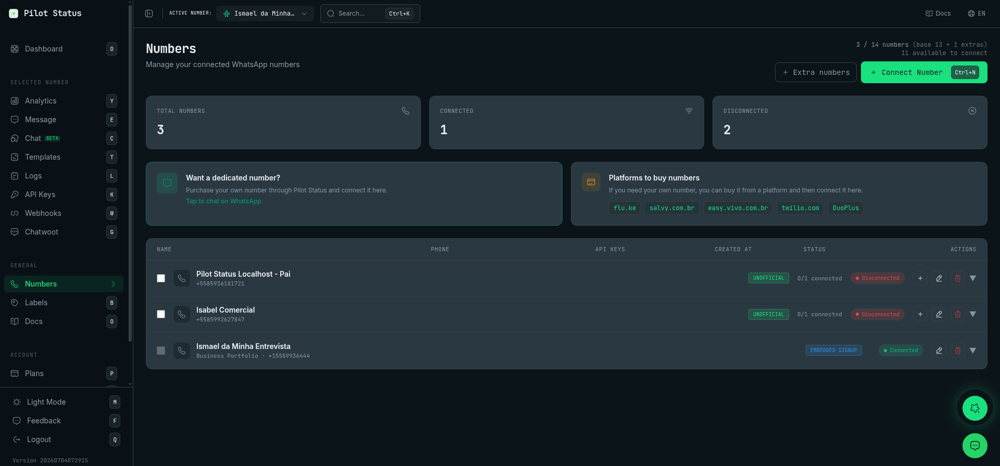
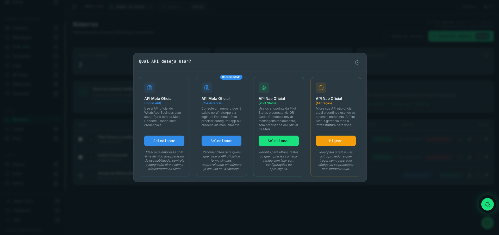
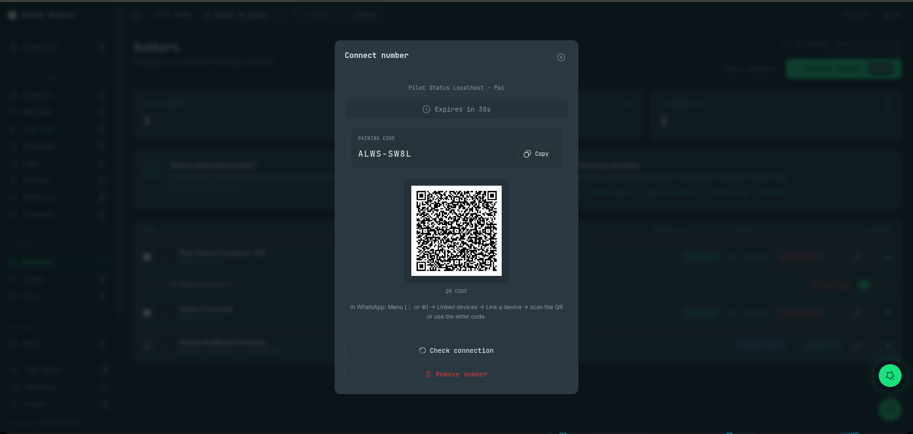
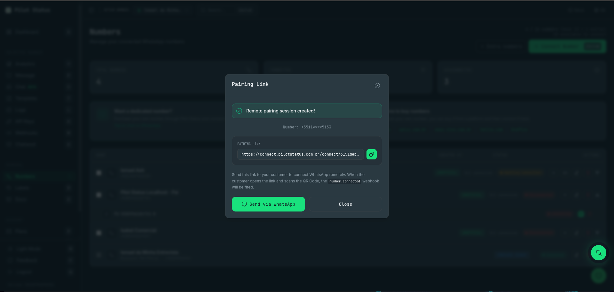

**Números** é onde vivem todos os números de WhatsApp do workspace: você conecta números novos, acompanha a saúde deles, copia os IDs e os valores de webhook que a Meta pede e remove números. Chega-se pelo item **Números** da barra lateral (atalho `n`), no caminho `/numbers`.

<Frame caption="A tela Números — uma linha por número, com status, API keys e ações.">
  
</Frame>

## Quem pode fazer o quê

Todo papel pode **abrir** a tela e ver os números (`numbers:read` vale para todos, inclusive Analista). O que cada papel pode **alterar** é mais restrito — botões que o papel não pode usar nem aparecem.

| Ação | Proprietário | Administrador | Atendente | Analista |
|---|:-:|:-:|:-:|:-:|
| Ver números, status, detalhes Meta, IDs de grupos e newsletters | ✓ | ✓ | ✓ | ✓ |
| **Conectar Número**, **Adicionar conexão**, **Reconectar**, **Reconectar com a Meta**, novo link de pareamento, **Já conectei, sincronizar**, **Sincronizar histórico**, **Retomar envio** | ✓ | ✓ | | |
| **Editar nome**, **Atualizar** (dados Meta), **Registrar na Cloud API** | ✓ | ✓ | | |
| **Habilitar chamada** | ✓ | ✓ | | |
| **Excluir número** / **Remover conexão**, ver **Excluídos recentemente** e **Restaurar** | ✓ | ✓ | | |
| **Excluir permanentemente** (purga) | ✓ | | | |
| Copiar o **Verify Token** da Meta no card do número | ✓ | | | |
| **Números extras**, **Adicionar número extra**, **Pagar agora** | ✓ | | | |

Atendente ou Analista limitado a números específicos vê só esses números — veja [Membros](/pt-BR/dashboard/members).

## O que aparece na tela

**Cabeçalho.** O título **Números** — *"Gerencie seus números WhatsApp conectados"* — e uma linha de uso que depende do plano:

- planos fixos: `usados / limite números`, com `(base N + M extras)` quando há números extras, e quantos estão **disponíveis para conectar**;
- **On Demand**: também o preço por número/mês;
- **Pay As You Go**: `N número(s) na cobrança` e o preço por número/mês. É uma contagem de **cobrança** — todo número da conta, conectado ou não (pareamentos não concluídos ficam de fora).

**Cards de resumo.** **Total de Números**, **Conectados** e **Desconectados**. Números bloqueados e pareamentos não concluídos não entram em nenhum dos dois últimos: aparecem citados abaixo do total (por exemplo *2 bloqueado(s) · 1 aguardando conexão*).

**Card de linhas telefônicas.** Para Proprietário e Administrador, um atalho para [Linhas telefônicas](/pt-BR/dashboard/phone-lines).

**Lista de números.** O cabeçalho traz **Nome · Telefone · Criado em**, **Status** e **Ações**. Cada linha mostra o nome e o telefone do número (números conectados com o Facebook mostram *Business Portfolio · &lt;telefone&gt;*) seguidos de **Criado em** e da data em que o número foi adicionado, uma etiqueta do tipo de conexão — **EMBEDDED SIGNUP**, **CLOUD API**, **MIGRATION** ou **UNOFFICIAL** —, nos números não oficiais quantas conexões estão de pé (*1/2 conectadas*), os selos abaixo, a pílula de status e os ícones de ação (**Adicionar conexão**, **Gerar novo link**, **Editar nome**, **Excluir número**, conforme o número e o seu papel). Clicar numa linha a expande. Sem nenhum número, a lista diz *Nenhum número conectado*.

### Selos de status numa linha

| Selo | Significado |
|---|---|
| **Conectado** / **Desconectado** | Estado da conexão. |
| **Aguardando conexão** | Um pareamento (QR, link remoto ou cadastro Meta) que não foi concluído. Dica: *"Conexão ainda não concluída: não é cobrada e é removida automaticamente após 24h. Gere um novo link para tentar de novo."* |
| **Bloqueado** / **Bloqueado para envio** | A Meta restringiu ou baniu o número, ou todas as conexões caíram; a fila de envio fica pausada. |
| **Shadowban** | O envio pela web está bloqueado e a fila **pausada**. O número continua funcionando no app do celular. Reduza o volume, espere algumas horas e clique em **Retomar envio**. |
| **Degradado** | O envio funciona, mas com problemas. |
| **Não registrado na Cloud API** | Número Meta cujo registro falhou — use **Registrar na Cloud API** na linha expandida. |
| **Recebimento represado** | O número continua enviando, mas as mensagens recebidas estão retidas na origem e devem chegar em lote. |
| **Conexão perdida** | O Pilot Status perdeu o acesso ao número na Meta (app removido do Gerenciador de Negócios ou WABA excluída). Se o acesso foi removido, clique em **Reconectar com a Meta** — o mesmo número volta, com as mesmas API keys e webhooks. |
| **Pagamento pendente** / **Além do plano** | O envio está bloqueado porque a cobrança do número extra falhou, ou porque o número passa do único número do plano Free. A linha expandida mostra a data em que ele será desconectado e o botão **Pagar agora** / **Adicionar número extra** (só Proprietário). |
| **Pagamento pendente na Meta** | *A Meta bloqueou os templates desta conta do WhatsApp Business por um problema de pagamento. O envio pela Pilot Status não foi pausado.* |
| **Histórico não importado** | O WhatsApp enviou o histórico enquanto a importação estava desligada (foi descartado), ou a Meta se recusou a enviá-lo. A Meta envia o histórico uma única vez. |

Quando a Meta aponta violação de política, a linha expandida mostra **Motivo informado pela Meta** com a violação, as restrições e a data.

### A linha expandida

**Números não oficiais** listam cada **conexão** (instância) com seu estado e, quando conectada, dois botões:

- **Grupos** — abre **Grupos WhatsApp**: todos os grupos com o **ID** e o botão **Copiar ID do grupo**, com filtro por nome. É assim que você obtém o `groupId` para [enviar para grupos](/pt-BR/api/groups).
- **Newsletters** — abre **Newsletters WhatsApp**: os canais e seus IDs (**Copiar ID do newsletter**). *"Lista em cache (até 1h)."* Veja [Canais (newsletters)](/pt-BR/api/newsletters).

…além de **Reconectar** (novo QR) e **Excluir** (remove aquela conexão).

Quando um número não oficial não consegue enviar, uma faixa vermelha na linha expandida explica o motivo — shadowban, todas as conexões caídas (*"Reconecte o número e clique em Retomar envio — as mensagens que ficaram aguardando saem em seguida."*) ou outro bloqueio — com o botão **Retomar envio**. Essa faixa e o botão existem só para números não oficiais.

**Números Meta** mostram:

- o selo **Webhook Configurado** / **Webhook Pendente**, a **URL:** do webhook com botão de copiar e o **Verify Token:** — o **Proprietário** tem botão de copiar; os demais leem *"Somente o dono do workspace pode ver"*. Esse bloco aparece para números conectados **por credenciais** (Cloud API), porque é neles que você cola o webhook no seu próprio app da Meta.
- **Phone Number**, **Phone ID**, **WABA ID** e **Business Account ID**, cada um com botão de copiar.
- **Sincronizar histórico** (só números em Coexistência) — *"Importa as mensagens anteriores deste número."*
- uma prévia no estilo WhatsApp do perfil comercial.
- **Detalhes Meta** — um retrato lido da Meta (buscado sozinho quando você expande uma linha que ainda não tem nenhum; **Atualizado:** mostra quando foi tirado). Ele traz:
  - selos de **Qualidade** (verde, amarelo ou vermelho), **Tier** — o limite de mensagens do próprio número, `—` quando a Meta não dá limite ao número — e um tier **Portfólio** quando o limite do Business Portfolio é diferente (*"Limite de mensagens do Business Portfolio, não deste número. A Meta exige o limite DO NÚMERO em 2 mil/24h para habilitar chamadas."*), **Chamadas** (**Ativadas**/**Desativadas**), throughput, o status na Meta (`CONNECTED`…), plataforma e modo da conta;
  - **Número:** status de verificação, **Nome:** — o status do nome de exibição na Meta — e **Novo nome:** quando uma troca de nome está em análise. Só `APPROVED` fica verde; `AVAILABLE_WITHOUT_REVIEW`, `PENDING_REVIEW` e `PENDING` ficam âmbar (o nome ainda não foi aprovado). Os selos **Oficial** e **PIN** aparecem quando se aplicam;
  - **Onboarding em**, **Perfil de negócio** (Sobre, Descrição, Email, Endereço, Vertical, Sites) e **Conta WhatsApp Business (WABA)** (Nome, Moeda, Fuso horário, País, Revisão da conta, Verificação do negócio, Propriedade, Namespace de templates, Negócio proprietário);
  - uma faixa vermelha **Impossibilitado de enviar** ou âmbar **Envio degradado** com o motivo, ou **Não registrado na Cloud API**, quando essa é a saúde do número;
  - *"Alguns dados não puderam ser carregados (token sem permissão ou expirado)."* quando parte do retrato falhou.

  Botões: **Atualizar** (Proprietário e Administrador) recarrega o retrato; **Habilitar chamada** (Proprietário e Administrador) aparece enquanto as chamadas não estão habilitadas; **Registrar na Cloud API** (Proprietário e Administrador) aparece só quando o número precisa — o registro falhou, a Meta o mostra como não verificado ou o informa como desconectado.

<Note>
  **Números em Coexistência não conseguem habilitar chamadas nem ser registrados na Cloud API** — a Meta recusa enquanto o número ainda vive no app WhatsApp Business. As mensagens continuam funcionando. O painel avisa isso na própria linha, em âmbar: *"Este número está em coexistência com o app WhatsApp Business (confirmado pela Meta)…"*, ou *"Este número provavelmente está em coexistência…"* quando a Meta ainda não confirmou.
</Note>

## Conectar um número

Clique em **Conectar Número** (atalho `N`). O primeiro diálogo, **Qual API deseja usar?**, oferece quatro cards — um pode trazer a etiqueta **Recomendado**:

<Frame caption="Qual API deseja usar? — os quatro cards de conexão.">
  
</Frame>

| Card | O que faz |
|---|---|
| **API Meta Oficial** (Cloud API) | Seu próprio app da Meta, conectado com credenciais. |
| **API Meta Oficial** (Coexistência) | Conecta um número que já está no WhatsApp via login do Facebook — sem app nem credenciais. |
| **API Não Oficial** (Pilot Status) | Endpoints do Pilot Status, conexão por QR code. |
| **API Não Oficial** (Migração) — botão **Migrar** | Traz uma instância de outro provedor e mantém o seu código. |

Se o plano não tem vaga livre, abre **Limite de números atingido**: mostra quantos números você usa e oferece **Fazer upgrade** (para [Planos](/pt-BR/dashboard/plans), para quem pode ver cobrança) e **Comprar número extra** / **Adicionar número extra** (Proprietário).

No **Pay As You Go**, todo formulário de conexão mostra o custo mensal estimado e *"Este número será cobrado (Pay As You Go) após a conexão"*, proporcional ao restante do ciclo.

### API Não Oficial — QR code ou link remoto

1. **Modo de pareamento**: **Direto (QR Code)** — escanear o QR no celular — ou **Remoto (Link)** — gerar um link para o seu cliente conectar remotamente.
2. Formulário **Conectar número**: **Nome** (ex.: *Suporte Principal*), **Número** e a caixa **Trazer as conversas antigas deste aparelho** — *"Importa até 30 dias de conversa no instante em que o número conectar. Ligado por padrão. ⚠️ A escolha é agora: o WhatsApp entrega esse histórico uma única vez, logo depois da conexão, e não existe como pedir de novo."* Depois, **Gerar QR Code**.
3. **Direto**: o diálogo mostra o **QR Code**, uma contagem regressiva (*"Expira em N s"*) e o **Código de pareamento** de letras com **Copiar**. No WhatsApp: *Menu → Aparelhos conectados → Conectar um aparelho*, e escaneie ou digite o código. Botões: **Gerar novo QR Code**, **Tentar obter QR novamente**, **Verificar conexão**, **Remover número**.

<Frame caption="Conectar número — QR code e código de pareamento de letras.">
  
</Frame>

4. **Remoto**: o diálogo **Link de Pareamento** — *"Sessão de pareamento remoto criada!"* — mostra o número mascarado e o link, com **Copiar link** e **Enviar via WhatsApp**. Quando o cliente abre o link e escaneia o QR, o webhook `number.connected` é disparado. O que o cliente vê está em [Página de conexão](/pt-BR/dashboard/connect-page).

<Frame caption="O diálogo Link de Pareamento do pareamento remoto.">
  
</Frame>

Um pareamento remoto não concluído fica **Aguardando conexão** (não é cobrado e é removido após 24h); o botão de link da linha (**Gerar novo link**) emite um novo.

### API Meta Oficial (Cloud API) — por credenciais

1. **Como deseja conectar?** — **Conectar agora** (*"Configure este número agora mesmo."*) ou **Remoto (Link)** (mandar um link para o seu cliente). O link abre o formulário de credenciais da [Página de conexão](/pt-BR/dashboard/connect-page), que acrescenta uma caixa para redirecionar automaticamente os webhooks da WABA para a Pilot Status.
2. **Conectar agora** abre o formulário com **Nome**, **Phone Number ID**, **WABA ID**, **System Token**, **App Secret** e **App ID** (todos obrigatórios; o telefone é lido da Meta com o Phone Number ID e o System Token — se falhar: *"Não foi possível obter o número pelo Phone Number ID. Verifique o ID e o System Token."*). Clique em **Conectar Meta**. Este formulário do painel não tem a caixa de redirecionamento: o webhook é sempre configurado por você.
3. **Número Meta Criado!** — *"Configure o webhook no Meta Business Dashboard:"* — mostra dois valores com botão de copiar:
   - **URL de Callback** — a URL para colar no seu app da Meta;
   - **Verify Token** — o token que a Meta devolve para verificar essa URL.

   Em seguida o diálogo lista os passos: 1. *Acesse o Meta App Dashboard* · 2. *WhatsApp → Configuração → Webhook* · 3. *Cole a URL de callback e o Verify token acima e clique em “Verificar e salvar”* · 4. *Assine os campos:* `messages`, `message_template_status_update`. Clique em **Concluir**.

<Warning>
  O **Verify Token** não se perde ao fechar esse diálogo: o **Proprietário** copia de novo na linha expandida do número (**Verify Token:** → copiar). Administrador, Atendente e Analista veem *"Somente o dono do workspace pode ver"*. Não é preciso pedir ao suporte. Pela API ele vem uma única vez, em `webhook.verifyToken` de [`POST /v1/numbers/meta`](/pt-BR/api/numbers/create).
</Warning>

### API Meta Oficial (Coexistência) — Conectar com Facebook

Escolha **Conectar agora** ou **Remoto (Link)**. **Conectar agora** mostra **Conectar com Facebook**: o Embedded Signup da Meta abre numa janela do Facebook, você escolhe ou cria a WABA e o número, e o número aparece conectado (*"Número conectado!"*). Sem credenciais e sem webhook para colar — o Pilot Status assina o webhook por você.

Se a janela do Facebook fechou antes de o dashboard perceber, a linha fica **Aguardando conexão** com o botão **Já conectei, sincronizar** — *"Se você já concluiu a conexão na janela do Facebook, sincronize para ativar o número aqui."*

### Migração de outro provedor

**Migrar instância** — *"Informe o nome da instância e o token que você usava no provedor anterior."* Campos: **Provedor de origem** (**Evolution GO** ou **Evolution V2**), **Nome**, o telefone, **Nome da instância antiga**, **ID da Instância (UUID)** e **Token da instância antiga**. Clique em **Migrar e conectar**; em seguida vem um QR code. O diálogo lembra: *"Após criar, aponte sua base URL para `https://pilotstatus.com.br/api/layer/<provedor>/` e seu código continuará funcionando."* — veja a [API Layer](/pt-BR/api/layer/overview).

## Outras ações numa linha

- **Adicionar conexão** (não oficial) — um segundo aparelho/conexão para o mesmo número; mesmo diálogo de QR.
- **Editar nome** — diálogo **Editar nome do número** com **Nome**. Para números migrados mostra também **Nome da Instância**, **ID da Instância (UUID)** e **Token da Instância** (os valores do provedor antigo usados pela API Layer).
- **Reconectar** — novo QR para uma conexão não oficial; **Reconectar com a Meta** para um número Meta que perdeu o acesso.
- **Retomar envio** (números não oficiais) — depois que uma desconexão ou um shadowban pausou a fila; as mensagens em espera saem logo em seguida. Aviso: *"Envio retomado. Comece devagar e acompanhe as falhas."*
- **PIN da verificação em duas etapas** — abre quando **Registrar na Cloud API** falha porque o número já tem um PIN definido por você. Campo **PIN de 6 dígitos** (*"não é o código recebido por SMS"*), botão **Registrar com este PIN**. Vários PINs errados fazem a Meta bloquear tentativas por um tempo. Não sabe o PIN? Desative a verificação em duas etapas no WhatsApp Manager e registre de novo. O PIN é enviado uma vez e não fica guardado.

## Números extras (Proprietário)

- **Números extras** (planos pagos de preço fixo) — um seletor de números extras recorrentes: *"Aumentar cobra o proporcional imediatamente; reduzir não gera reembolso."* Mostra o **Limite total**; **Salvar**.
- **Adicionar número extra** (Free e On Demand) — um seletor de **Quantidade**, depois o preço por número, **Cobrança agora (proporcional)**, **Depois, por mês** e **Como cobrar**: **Créditos (carteira)** (com saldo; o cartão salvo cobre o restante) ou **Cartão**; sem nenhum dos dois você vai para o checkout. **Confirmar compra**. Se você já tem vagas pagas vazias, o diálogo avisa que a compra abre outra vaga.
- **Pagar agora** — num número com **Pagamento pendente**: cobra a carteira ou o cartão salvo na hora e libera o envio.

O Pay As You Go não tem compra de número extra: cada conexão paga o seu próprio proporcional.

## Excluir, restaurar e excluir permanentemente

### Excluir número

O ícone de lixeira numa linha (Proprietário e Administrador) abre **Excluir Número** — *"Tem certeza que deseja excluir o número &lt;nome&gt; (&lt;telefone&gt;)"* — ou, para um número Meta, **Remover Número Meta**. Nos dois é preciso **digitar o telefone da linha** (*"Digite o número de telefone desta linha para confirmar."*); o botão (**Excluir** / **Confirmar Remoção**) fica desabilitado até os dígitos baterem, e o servidor confere de novo o número digitado.

Quando você tem números extras pagos (planos fixos e On Demand), o diálogo acrescenta: *"Isto não reduz sua capacidade paga: o slot fica livre para reconectar outro número neste ciclo. Para reduzir a capacidade, use a aba Geral em Planos — o novo valor só vale no próximo ciclo."*

O que a confirmação faz, para qualquer tipo de número:

- toda conexão do número é desconectada e removida na hora (o aparelho não oficial é desvinculado do celular);
- o número sai da lista e da contagem de cobrança, as API keys dele param de funcionar já na próxima requisição, e uma cobrança de número extra pendente nele é descartada;
- `number.removed` é enviado aos webhooks inscritos naquele número;
- o número vai para **Excluídos recentemente**, com histórico, templates, webhooks e API keys guardados por 30 dias.

#### Remover Número Meta

O diálogo Meta diz: *"Ao remover este número, as seguintes ações serão executadas no Facebook: revogar acesso do app ao perfil, cancelar inscrição em webhooks e desregistrar o número do WhatsApp Business API. Confirma a remoção de &lt;nome&gt; (&lt;telefone&gt;)"*.

Essas etapas na Meta **não** acontecem quando você confirma: enquanto o número está em **Excluídos recentemente**, nada é alterado na Meta, e é isso que permite ao **Restaurar** trazê-lo de volta. Elas só rodam quando o número é excluído de vez — **Excluir permanentemente**, ou automaticamente depois dos 30 dias — e só para número conectado **com o Facebook** (Embedded Signup): a Pilot Status desregistra o número da Cloud API e, quando nenhum outro número ativo usa a mesma WABA, também cancela a inscrição da WABA nos webhooks e revoga o acesso do app. Essas chamadas são feitas na base do melhor esforço. Para número conectado **com as suas próprias credenciais** (Cloud API), nada é alterado na Meta em momento algum: o webhook e o registro continuam no seu app da Meta até você removê-los lá.

Numa tela estreita (largura de celular), o ícone de lixeira da linha aparece em todos os números — inclusive números Meta e números com mais de uma conexão — e abre o mesmo diálogo.

### Excluídos recentemente

Proprietário e Administrador veem o bloco **Excluídos recentemente** no fim da tela — *"Ficam recuperáveis por 30 dias. Depois disso a exclusão é definitiva — e o número volta a poder ser conectado por qualquer conta."* Cada item mostra os dias restantes (*purga a qualquer momento* no último dia) e:

- **Restaurar** — pergunta antes. **Restaurar número?** mostra o número, diz que ele volta **DESCONECTADO** e quanto restaurar pode custar: no limite de números, *"Sua conta está no limite de números (N de N). Se este número já tinha sido conectado antes, restaurá-lo é cobrado agora como um número extra — primeiro dos créditos, depois do cartão"* (com o preço mensal por número no On Demand e no Pay As You Go); com vaga, que ele ocupa uma das vagas livres sem cobrança extra; se o plano não carregou, que **pode** haver cobrança. **Restaurar** confirma, **Cancelar** não faz nada. Restaurar devolve o número (com histórico, templates, webhooks e API keys) **desconectado**: você reconecta do zero (novo QR ou novo provisionamento na Meta), e `number.restored` é enviado. Se o workspace já está no limite de números, restaurar um número que já tinha conectado antes **compra um número extra** para ele, cobrado da carteira ou do cartão salvo. Recusas: *"A janela de 30 dias expirou: este número não pode mais ser restaurado."*, *"Este número já foi reconectado em outro lugar e não pode ser restaurado."*, *"Restaurar este número passa do limite do seu plano, e o número extra não pôde ser cobrado. Adicione créditos ou um cartão e tente de novo."* e *"O pagamento do número extra não foi concluído, e o número NÃO foi restaurado. Confira seu extrato antes de tentar de novo."*
- **Excluir permanentemente** (Proprietário) — diálogo **Excluir permanentemente**: *"Não tem como desfazer. Confirma a exclusão definitiva de &lt;número&gt;"*. Antes, ele conta o que vai embora — *"Isto apaga para sempre o número e todo o histórico dele: N conversas e N mensagens."* — e, em **Também serão apagados:**, registros de envio, registros de chamada, modelos de mensagem, webhooks configurados só para este número, chaves de API deste número, a integração com o Chatwoot e *"o registro do número na API oficial da Meta"* (listado só quando o desregistro na Meta vai de fato rodar). Ele sugere as alternativas (**Restaurar**, ou simplesmente deixar que seja apagado sozinho). Se a contagem falhar, ele manda considerar que tudo será apagado. Você digita o número para confirmar.

### Remover conexão

**Remover conexão** (o ícone de lixeira de uma conexão de um número não oficial) — *"Isto desconecta o aparelho e apaga esta conexão de &lt;conexão&gt;"* — com a nota *"Diferente de excluir o número: a conexão NÃO vai para a lixeira e não pode ser restaurada. O número continua existindo e pode ser conectado de novo do zero."* Confirmada digitando o telefone da conexão.

## Fazer pela API / MCP

| Ação no dashboard | API | Tool MCP |
|---|---|---|
| Listar / ver um número (status, detalhes Meta, `?refresh=1` = Atualizar dados Meta) | [`GET /v1/numbers`, `GET /v1/numbers/{id}`](/pt-BR/api/numbers/list) | `numbers_list`, `numbers_get` |
| Status da conexão | [`GET /v1/numbers/{id}/status`](/pt-BR/api/numbers/status) | `numbers_status` |
| Conectar não oficial (QR) | [`POST /v1/numbers`](/pt-BR/api/numbers/create) | `numbers_create` |
| Novo QR / reconectar | [`GET /v1/numbers/{id}/connect`](/pt-BR/api/numbers/create) | `numbers_connect` |
| Link de pareamento remoto (não oficial ou Meta) | [`POST /v1/numbers/remote-pairing`](/pt-BR/api/numbers/remote-pairing) | `numbers_remote_pairing` |
| Meta por credenciais (devolve URL de Callback + Verify Token uma vez) | [`POST /v1/numbers/meta`](/pt-BR/api/numbers/create) | — |
| Conectar com Facebook (Embedded Signup) | por um link de pareamento remoto com `metaFlow` | `numbers_remote_pairing` |
| Migração | [API Layer](/pt-BR/api/layer/overview) (o dashboard cria a instância) | só no dashboard |
| Configurações do número (histórico, retenção, confirmação de leitura) | [`PATCH /v1/numbers/{id}`](/pt-BR/api/numbers/settings) | `numbers_settings_update` |
| Desconectar sem excluir | [`POST /v1/numbers/{id}/logout`](/pt-BR/api/numbers/logout) | — |
| Excluir / Restaurar / Excluir permanentemente | [`DELETE /v1/numbers/{id}`, `POST …/restore`, `DELETE …/purge`](/pt-BR/api/numbers/create) | `numbers_delete`, `numbers_restore`, `numbers_purge` |
| Pagar agora | [`POST /v1/numbers/{id}/pay`](/pt-BR/api/numbers/pay) | `numbers_pay` |
| Números extras | [`/v1/subscription/extra-numbers`](/pt-BR/api/extra-numbers) | `subscription_extra_numbers_get`, `subscription_extra_numbers_add`, `subscription_extra_numbers_remove` |
| Habilitar chamada | [`PUT /v1/calls/settings`](/pt-BR/api/calls/endpoints) | `call_enable`, `call_settings_update` |
| Lista de grupos | [`GET /v1/groups`](/pt-BR/api/groups) | `groups_list` |
| Lista de newsletters | [`GET /v1/newsletters`](/pt-BR/api/newsletters) | `newsletters_list` |
| Editar nome, Sincronizar histórico, Retomar envio, Registrar na Cloud API (PIN), copiar o Verify Token depois | — | só no dashboard |

Os eventos de ciclo de vida (`number.connected`, `number.removed`, `number.restored`…) estão em [Eventos de webhook](/pt-BR/api/webhooks/events).
