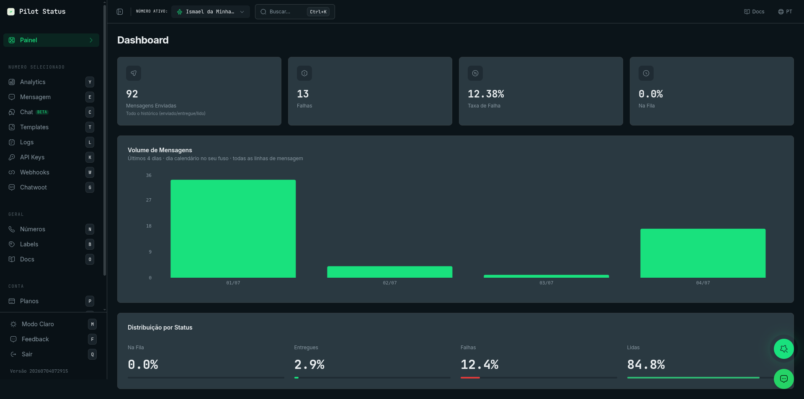
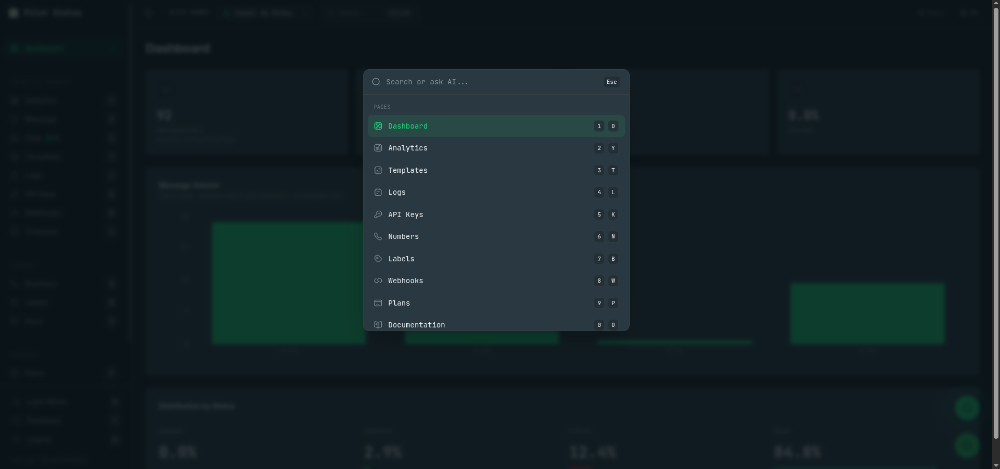

O painel do Pilot Status é o aplicativo web em `https://pilotstatus.com.br/dashboard`. Tudo o que você faz com um número de WhatsApp — conectar, enviar e receber mensagens, conversar ao vivo, criar templates e Flows, ler logs, configurar webhooks e gerenciar chaves, membros e cobrança — tem uma tela nele. Esta página descreve a **tela inicial** (`/dashboard`) e aponta para uma página por tela.

<Tip>
  Procurando uma credencial ou um valor? Secrets de assinatura de webhook, chaves de API, chaves do endpoint de Flow e valores parecidos aparecem no painel, na tela que os cria — não com o suporte. Use o **Índice de telas** no fim desta página para achar a página certa.
</Tip>

<Frame caption="A home do painel do Pilot Status — KPIs, volume de mensagens e distribuição por status.">
  
</Frame>

## Como o painel é organizado

A barra lateral esquerda agrupa as telas nesta ordem:

| Grupo | Telas (rótulo na barra lateral → caminho) |
| --- | --- |
| *(topo)* | **Painel** → `/dashboard` |
| **Numero selecionado** — agem sobre o número escolhido no seletor de número do cabeçalho | **Analytics** → `/analytics`, **Anúncios** → `/ads`, **Mensagem** → `/messages`, **Chat** → `/chat`, **Flows** → `/flows`, **Templates** → `/templates`, **Logs** → `/logs`, **API Keys** → `/api-keys`, **Webhooks** → `/webhooks`, **Chatwoot** → `/chatwoot` |
| **Workspace** | **Números** → `/numbers`, **Linhas telefônicas** → `/linhas`, **Labels** → `/labels`, **API Keys** → `/workspace-api-keys`, **Docs** (abre este site) |
| **Conta** | **Planos** → `/plans`, **Perfil** → `/profile` |

<Note>
  A barra lateral tem **duas entradas chamadas API Keys**. A do grupo **Numero selecionado** (`/api-keys`) guarda a chave `ps_` do número selecionado. A do grupo **Workspace** (`/workspace-api-keys`) guarda as chaves do workspace (a chave principal e as chaves nomeadas). Suas chaves pessoais de conta (`ps_account_`) ficam em **Perfil**. Veja [Autenticação da API](/pt-BR/api/authentication).
</Note>

A barra lateral mostra só as telas que o seu [papel](/pt-BR/concepts/roles-and-permissions) pode abrir. **Flows** aparece só quando o número selecionado é oficial (Meta Cloud API). **Anúncios**, **Chat**, **Flows** e **Linhas telefônicas** têm o selo **beta**.

### Atalhos de teclado

Fora de um campo de texto, aperte uma única letra para ir a uma tela: **D** Painel, **Y** Analytics, **S** Anúncios, **E** Mensagem, **C** Chat, **H** Flows, **T** Templates, **L** Logs, **K** API Keys (número), **W** Webhooks, **G** Chatwoot, **N** Números, **I** Linhas telefônicas, **B** Labels, **V** API Keys (workspace), **O** Docs, **P** Planos, **U** Perfil. **M** alterna entre modo claro e escuro, **F** abre o feedback e **Q** sai da conta.

### Paleta de comandos

<Frame caption="Ctrl+K abre a paleta de comandos — pule para qualquer página por atalho de número/letra ou pergunte à IA.">
  
</Frame>

Aperte **Ctrl+K** (**⌘K** no macOS) para abrir a paleta (**Buscar ou perguntar à I.A...**). Digite para filtrar páginas e ações, aperte **1**–**9** ou **0** para escolher um resultado ou — quando nada corresponde — aperte **Enter** ou clique em **Perguntar à I.A.** para receber uma resposta baseada na documentação. **Copiar resposta da I.A.** copia a resposta.

## A tela inicial (`/dashboard`)

Clique em **Painel** na barra lateral (ou aperte **D**). É a tela onde você chega depois de entrar. Se o workspace não tiver número conectado, aparece no topo o aviso **Nenhum número conectado** com o botão **Adicionar Número**, que abre o assistente de conexão em [Números](/pt-BR/dashboard/numbers).

Diferente das telas do grupo **Numero selecionado**, a tela inicial soma **todos os números do workspace** (ou, para um membro restrito a alguns números, só os números liberados a ele). Ela se atualiza sozinha e quando você volta à aba; os valores podem ter até cerca de um minuto de atraso.

### Cartões de KPI

| Cartão | O que conta |
| --- | --- |
| **Mensagens Enviadas** | Mensagens enviadas em todo o histórico com status enviada, entregue ou lida (*Todo o histórico (enviado/entregue/lido)*). |
| **Mensagens Recebidas** | Mensagens recebidas em todo o histórico, de todos os provedores (*Todo o histórico (todos os webhooks)*). |
| **Falhas** | Mensagens enviadas em todo o histórico com status de falha. |
| **Taxa de Falha** | Falhas ÷ (enviadas + falhas), com duas casas decimais. |
| **Na Fila** | A **porcentagem** das mensagens de saída que ainda estão na fila — não uma contagem. |

### Volume de Mensagens

Um gráfico de mensagens por dia nos **Últimos 4 dias · dia calendário no seu fuso · todas as linhas de mensagem**. Os dias são calculados no fuso horário do seu navegador.

### Distribuição por Status

Quatro porcentagens sobre todas as mensagens de saída, cada uma com uma barra: **Na Fila**, **Entregues** (enviadas + entregues somadas), **Falhas** e **Lidas**.

### Top Números

Os 5 números com maior volume em todo o histórico (**Por volume enviado + recebido**), cada um com o nome (ou o telefone) e as contagens ↑ enviadas e ↓ recebidas. O bloco fica oculto enquanto não há tráfego.

### Quem pode ver

Todos os papéis — **Proprietário**, **Administrador**, **Atendente** e **Analista** — abrem a tela inicial (permissão `analytics:read`).

### Pela API / MCP

Os totais de todo o histórico e de todo o workspace da tela inicial são **exclusivos do painel**. Para KPIs por número e série diária de 7, 30 ou 90 dias, use [`GET /v1/analytics/dashboard`](/pt-BR/api/analytics) (ferramenta MCP `analytics_dashboard`), que devolve os dados da tela [Analytics](/pt-BR/dashboard/logs-analytics) para o número da chave de API.

## Índice de telas

<CardGroup cols={2}>
  <Card title="Números" icon="phone" href="/pt-BR/dashboard/numbers">
    Conecte, reconecte, configure e apague números de WhatsApp; status de conexão e assistente de conexão.
  </Card>
  <Card title="Chat ao vivo" icon="message" href="/pt-BR/dashboard/live-chat">
    Caixa de entrada do WhatsApp: conversas, respostas, mídia, chamadas, encaminhamento, dados do contato e do grupo.
  </Card>
  <Card title="Enviar mensagens" icon="paper-plane" href="/pt-BR/dashboard/send-messages">
    A tela **Mensagem**: envie um template aprovado para uma lista de destinatários vinda de uma label ou de uma planilha, agora ou agendado.
  </Card>
  <Card title="Templates" icon="rectangle-list" href="/pt-BR/dashboard/templates">
    Crie, edite, teste e envie templates à Meta; sincronização, insights e o exemplo de requisição da API.
  </Card>
  <Card title="Flows" icon="diagram-project" href="/pt-BR/dashboard/flows">
    WhatsApp Flows: criar, publicar, pré-visualizar, rastros e as chaves do endpoint e o secret de assinatura.
  </Card>
  <Card title="Logs e Analytics" icon="chart-bar" href="/pt-BR/dashboard/logs-analytics">
    Histórico de mensagens, detalhes, reenvio, cancelamento de agendadas e analytics por número.
  </Card>
  <Card title="Labels" icon="tag" href="/pt-BR/dashboard/labels">
    Contatos e labels usados para segmentar e para envios em massa.
  </Card>
  <Card title="Webhooks" icon="link" href="/pt-BR/dashboard/webhooks">
    Endpoints de webhook, eventos e o secret de assinatura exibido depois de criar um webhook.
  </Card>
  <Card title="Chaves de API" icon="key" href="/pt-BR/dashboard/api-keys">
    Chaves do número e do workspace: ver, copiar, regenerar.
  </Card>
  <Card title="Chatwoot" icon="headset" href="/pt-BR/dashboard/chatwoot">
    Conecte um número a uma caixa de entrada do Chatwoot.
  </Card>
  <Card title="Anúncios" icon="bullhorn" href="/pt-BR/dashboard/ads">
    Desempenho dos anúncios de clique para o WhatsApp.
  </Card>
  <Card title="Página de conexão" icon="qrcode" href="/pt-BR/dashboard/connect-page">
    A página que você compartilha para outra pessoa conectar um número.
  </Card>
  <Card title="Linhas telefônicas" icon="phone-volume" href="/pt-BR/dashboard/phone-lines">
    Compre e gerencie linhas telefônicas virtuais.
  </Card>
  <Card title="Planos" icon="credit-card" href="/pt-BR/dashboard/plans">
    Assinatura, cobrança e forma de pagamento.
  </Card>
  <Card title="Perfil" icon="user" href="/pt-BR/dashboard/profile">
    Seu perfil, chaves de API da conta e preferências.
  </Card>
  <Card title="Acesso à conta" icon="lock" href="/pt-BR/dashboard/account-access">
    Login, sessões e acesso à sua conta.
  </Card>
  <Card title="Membros" icon="users" href="/pt-BR/dashboard/members">
    Convide membros, defina papéis e restrinja-os a números.
  </Card>
</CardGroup>
