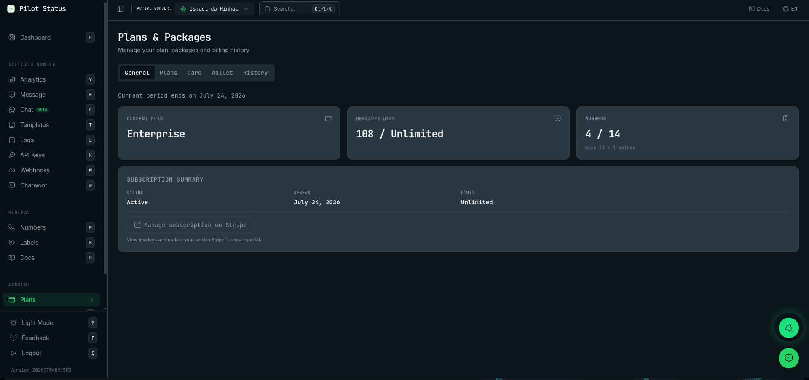
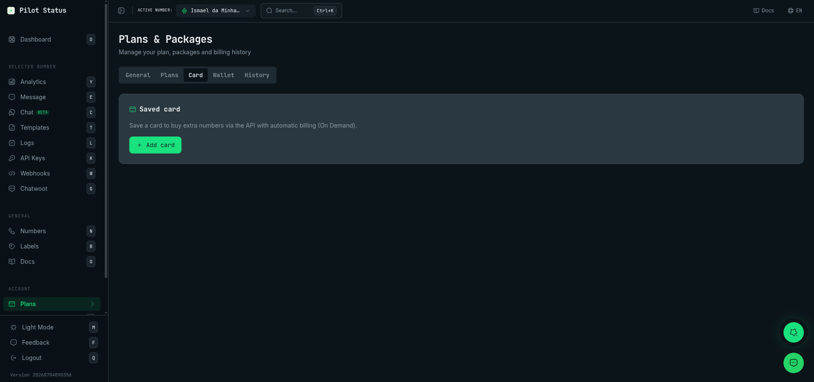
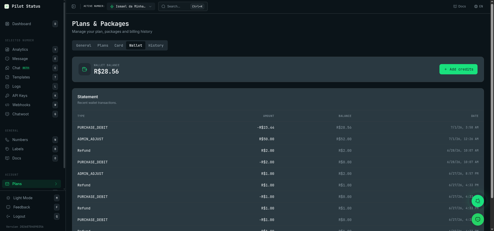

**Planos & Pacotes** é onde o workspace vê e paga o que usa: o plano, os números extras, a carteira pré-paga, o cartão salvo, os recibos e a trilha completa de eventos de cobrança. Preços e o que cada plano inclui estão em [Planos](/pt-BR/plans); esta página descreve a tela.

## Como chegar

- Menu lateral: **Planos** (atalho de teclado: `p`), ou **Planos** na paleta de comandos (`Ctrl+K` / `⌘K`).
- Caminho: `/plans`. Cada aba tem o próprio link com `?tab=`: `/plans?tab=general`, `plans`, `card`, `wallet`, `finance`, `history`. Um e-mail de aviso de cobrança pode abrir esta tela direto.
- O título da tela é **Planos & Pacotes**, com o subtítulo **Gerencie seu plano, pacotes e veja o histórico de billing**.

## Quem vê o quê

A tela é para **Proprietário** e **Administrador**. Agente e Analista não a veem (o item **Planos** não aparece no menu).

| Aba | Proprietário | Administrador |
| --- | --- | --- |
| **Geral** | Tudo, inclusive **Cancelar Plano** / **Reativar Plano** | Só leitura (veja a nota abaixo) |
| **Planos** | Sim | Oculta |
| **Cartão** | Sim | Oculta |
| **Carteira** | Saldo, extrato e **Adicionar créditos** | Saldo e extrato; sem **Adicionar créditos** |
| **Financeiro** | Tudo; edita os **Dados de faturamento** | Lê tudo; os **Dados de faturamento** mostram CPF/CNPJ e endereço mascarados, com **Só o proprietário da conta pode alterar estes dados.** |
| **Histórico** | Sim | Sim |

Mexer em dinheiro — contratar ou trocar de plano, pagar, salvar ou remover cartão, recarregar a carteira, cancelar, mudar a capacidade paga, editar os dados de faturamento — é **só do Proprietário**. Uma aba oculta continua oculta mesmo aberta por link (`/plans?tab=card` volta para **Geral**).

<Note>
  Em **Geral**, o Administrador ainda vê **Gerenciar assinatura no Stripe**, **Pagar fatura**, **Agendar redução** e **Cancelar redução**, mas o servidor só aceita essas ações do Proprietário e responde com erro para o Administrador. Peça ao Proprietário.
</Note>

<Frame caption="Planos & Pacotes — a aba Geral.">
  
</Frame>

## Geral

### Avisos no topo

- **Cobrança suspensa** — os envios estão pausados. O texto diz por quê e desde quando:
  - a cobrança da assinatura foi recusada → **Pagar fatura** (abre o portal do Stripe);
  - saldo insuficiente → **Adicionar créditos** (vai para a aba **Carteira**) e, quando ainda não há cartão salvo, **Adicionar cartão** — salvar um cartão também quita o ciclo em aberto;
  - a reativação depende do suporte → nenhum botão, só **Suporte necessário**, e o texto pede para informar o ciclo que ele mostra.
- **Pagamento pendente** — a última cobrança da assinatura foi recusada, mas os envios ainda não pararam. Diz até quando pagar a fatura em aberto, com **Pagar fatura**.
- **Fim do período atual: …** — o fim do período de cobrança atual.

Envios pela API com a cobrança suspensa respondem `422 BILLING_SUSPENDED` — veja [Planos → Modos de faturamento](/pt-BR/plans#modos-de-faturamento).

### Cartões

- **Plano Atual** — **Gratuito**, **Básico**, **Premium** ou **Enterprise**; os outros planos aparecem pelo código, como `ON_DEMAND`, `PAY_AS_YOU_GO` ou `CUSTOM`.
- **Mensagens Usadas** — mensagens usadas / limite do plano, ou **Limite excedido**.
- **Uso** — só no plano Free: a porcentagem da cota de mensagens, com uma barra.
- **Números** — números conectados / números permitidos, com **base … + … extras** quando há números extras. No Pay As You Go: **… número(s) na cobrança**.

### Ciclo de cobrança

Só em planos pagos. Duas colunas:

- **Ciclo atual** — datas de início → fim, **Capacidade: … número(s)** (ou os números na cobrança, no Pay As You Go) e, no On Demand, **Valor do ciclo atual**.
- **Próximo ciclo** — datas, **Capacidade mantida: …** ou **Capacidade cai de … para … número(s)**, e **Valor do próximo ciclo**.

Mudar a capacidade paga (qualquer plano com números extras pagos, menos Pay As You Go):

- **Reduzir para** [número] **nº pagos** → **Agendar redução**. A nova capacidade só passa a valer, e a ser cobrada, no próximo ciclo; você mantém a atual até lá. Não dá para ficar abaixo dos números conectados (**Você tem números conectados acima desse alvo. Desconecte números antes de reduzir.**).
- Com uma redução agendada, **Cancelar redução** mantém a capacidade atual no próximo ciclo.
- A aba lembra: **Sua capacidade paga é um direito de 30 dias: excluir um número não a reduz.** No Pay As You Go ela diz, em vez disso, que o próximo ciclo é calculado pelos números ativos na renovação.

Comprar números extras não é feito aqui: é na tela **Números** (o diálogo de compra) ou pela API. Veja [Números extras e On Demand](/pt-BR/api/extra-numbers).

### Resumo da Assinatura

**Status** (**Ativo**, **Pagamento pendente** ou **Cancelado**), **Renovação** (data) e **Limite** (mensagens).

- **Gerenciar assinatura no Stripe** — aparece quando o plano é pago por cartão pelo Stripe. Abre o portal seguro da Stripe numa nova página, onde você vê as faturas do Stripe e atualiza o cartão da assinatura.
- **Cancelar Plano** (Proprietário) — abre o diálogo **Cancelar Plano**: **Seu plano continuará ativo até o fim do período de cobrança. Depois será migrado para FREE.** e **Você pode reativar a qualquer momento antes do fim do período.** Botões: **Confirmar Cancelamento** e **Voltar**. Depois de cancelar, a aba mostra **Cancelado — válido até …** e **Reativar Plano**.

## Planos

Só o Proprietário. Um seletor **Mensal** / **Anual** (o anual mostra **-20%**), a linha **Números: … / …** e um cartão por plano — **Gratuito**, **Básico**, **Premium** (marcado **Popular**) e **Enterprise** — com preço, quantos números, quantas mensagens e os recursos. Preços: [Planos](/pt-BR/plans#comparação-de-planos).

O botão de cada cartão depende da sua situação:

| Botão | Quando | O que acontece |
| --- | --- | --- |
| **Plano Atual** | É o seu plano | Nada (desabilitado). Com pagamento pendente, vira **Pagamento pendente** e abre o portal do Stripe. |
| **Cartão de Crédito** / **PIX** | Você ainda não tem assinatura no cartão | **Cartão de Crédito** abre o Checkout do Stripe. **PIX** abre o diálogo **Pagamento PIX** (só aparece com o painel em português). |
| **Fazer upgrade** / **Fazer downgrade** | Você já paga um plano no cartão | Abre o diálogo **Fazer upgrade** ou **Fazer downgrade**. |

- **Fazer upgrade** — **A diferença proporcional será cobrada agora no cartão cadastrado e o novo plano entra em vigor imediatamente.** → **Confirmar** / **Voltar**.
- **Fazer downgrade** — **A mudança entra em vigor no fim do período atual (…); você mantém o plano atual até lá. Sem reembolso.** Também avisa: **Se você tiver mais números conectados do que o plano escolhido permite, desconecte-os antes de continuar.** → **Confirmar** / **Voltar**. A confirmação diz **Downgrade agendado para …**.

### Diálogo Pagamento PIX

Mostra o que você está pagando, o valor, **Expira em** (data e hora), o **QR code** e **Copiar código PIX** (o Pix copia e cola). Depois de pagar no app do banco, clique em **Verificar Pagamento**: **Pagamento confirmado!** ou **Pagamento ainda pendente.** **Fechar** fecha o diálogo.

<Warning>
  O código Pix e o QR code só existem neste diálogo. Depois de fechá-lo, eles não aparecem de novo: comece o pagamento outra vez pelo cartão do plano para gerar um código novo. Um Pix não pago até **Expira em** deixa de funcionar.
</Warning>

Um plano pago por Pix renova pela carteira a cada ciclo — veja [Modos de faturamento](/pt-BR/plans#modos-de-faturamento).

**Precisa de mais números?**, no fim da aba, tem **Falar com nosso time** (WhatsApp), para mais de 13 números ou um plano sob medida.

## Cartão

Só o Proprietário. **Cartão salvo** — o cartão usado para comprar números extras pela API e nas cobranças automáticas (On Demand, renovações e linhas quando a carteira não cobre).

- Com cartão: a **bandeira** e **•••• 4 últimos dígitos**, e **Remover cartão**. A remoção é imediata, sem diálogo de confirmação. Ela é recusada enquanto o cartão é necessário: **Cancele o On Demand antes de remover o cartão.** ou **Desative a auto-recarga antes de remover o cartão.**
- Sem cartão: **Adicionar cartão** abre uma página do Stripe para salvar um; ao terminar, você volta para `/plans`.
- **Usando o cartão do workspace … como reserva** — o workspace não tem cartão próprio, mas as cobranças recorrem ao cartão de outro workspace (o [cartão compartilhado](/pt-BR/reseller-billing) de um revendedor). Mostra a bandeira e os 4 últimos dígitos desse cartão, só para leitura. **Um cartão próprio tem prioridade sobre o cartão de reserva.**

O número completo do cartão nunca aparece na Pilot Status; quem o guarda é o Stripe.

<Frame caption="A aba Cartão com um cartão salvo.">
  
</Frame>

## Carteira

A carteira pré-paga: **Saldo da carteira** (na moeda da carteira) e o **Extrato** — **Movimentações recentes da carteira.**, com **Tipo** (**Recarga**, **Débito**, **Crédito**, **Estorno**, **Ajuste**; nas linhas, **Compra** e **Mensalidade**), **Valor**, **Saldo** e **Data**. Os botões **Todos**, **WhatsApp** e **Linhas** filtram por produto.

**Adicionar créditos** (Proprietário) abre o diálogo **Adicionar créditos**:

1. **Valor** (na moeda da carteira).
2. **Forma de pagamento** — **PIX** (só carteiras em BRL; nas outras, **Pix está disponível apenas para carteiras em BRL.**) ou **Cartão**. Com cartão salvo, escolha **Usar cartão •••• 1234** (cobrado na hora, sem página extra: **Créditos adicionados.**) ou **Outro cartão** (abre o Checkout do Stripe).
3. **Continuar**.

No Pix, o diálogo mostra o QR code e **Copiar código Pix**, e **Após o pagamento, o saldo é creditado automaticamente.** — **Concluir** fecha. Como no Pix do plano, o código não aparece de novo depois de fechar o diálogo; comece uma nova recarga se precisar.

<Frame caption="A aba Carteira — saldo, Adicionar créditos e o extrato.">
  
</Frame>

## Financeiro

**Quanto a conta gastou, o que as Linhas vão cobrar, para quem os recibos são emitidos e os documentos de cada cobrança paga.** Quatro seções:

- **Gastos consolidados** — tudo o que foi cobrado, por produto e por mês (no fuso da conta): **Assinatura do plano**, **Mensalidade pela carteira (plano e números extras)**, **Números extras**, **Linhas telefônicas**, **Pacotes de mensagens**. **Período**: **2 meses**, **6 meses** ou **12 meses**; os dois meses mais recentes são cartões (**Mês atual**, **Mês anterior**) e **Meses anteriores** é uma tabela. Também mostra **Carteira** (**Recargas**, **Usado em produtos**, **Estornado para a carteira**), que não entra no total, e **Devolvido a você** (**Estornos (cartão ou Pix)**, **Contestações perdidas no banco**). Os custos das mensagens da Meta não estão aqui: a Meta cobra direto (**Ver preços da Meta**).
- **Cobranças das Linhas** — saldo da carteira, cobertura das próximas renovações e o histórico de cobranças das linhas. Descrita em [Linhas telefônicas no painel](/pt-BR/dashboard/phone-lines#as-linhas-em-planos).
- **Dados de faturamento** — para quem os recibos e comprovantes são emitidos: **País** (**Brasil** ou **Outro país**, com **Código do país (2 letras)**), **Tipo de documento**, **CPF ou CNPJ**, **Nome completo ou razão social**, **E-mail de cobrança**, **CEP / código postal** (no Brasil o endereço é buscado pelo CEP), **Endereço**, **Número**, **Complemento (opcional)**, **Bairro (opcional)**, **Cidade**, **Estado (UF)**. **Usar os dados da verificação das Linhas** preenche o formulário com a verificação do titular das linhas. **Editar** → **Salvar dados** (Proprietário). Ao salvar, nome, e-mail, endereço e CPF/CNPJ também são atualizados no cadastro do Stripe, e as próximas faturas do cartão saem com eles. **Atualizado em …** mostra a última alteração.
- **Recibos e faturas** — uma linha por cobrança paga, com **Carregar mais**. **Comprovante** baixa um arquivo HTML que você abre e imprime ou salva como PDF; vale para qualquer forma de pagamento e não é nota fiscal. **Fatura/recibo Stripe** abre o documento do Stripe, que só existe quando houve cartão (senão: **Esta cobrança não tem documento no Stripe. Use o comprovante.**).

<Note>
  Para o Administrador, o CPF/CNPJ e o endereço em **Dados de faturamento** — e nos comprovantes que esse Administrador baixa — aparecem mascarados. Só o Proprietário os vê completos.
</Note>

## Histórico

**Eventos de Billing** — a linha do tempo de tudo o que aconteceu na cobrança da conta, do mais recente ao mais antigo, com **Carregar mais**. Cada evento mostra o nome, o valor, a forma de pagamento e a data. Exemplos: checkout iniciado, concluído ou cancelado; assinatura ativada, renovada ou cancelada; ajuste proporcional de troca de plano pago; números extras comprados ou removidos; redução de números agendada ou cancelada; créditos adicionados; recarga não concluída; cartão salvo ou removido; cartão de reserva vinculado ou desvinculado; mensalidade paga ou em aberto; conta suspensa por falta de pagamento e reativada; preço atualizado; contestação no banco; estorno no PSP; além dos eventos das linhas. Mais em [Planos → Histórico de cobrança](/pt-BR/plans#histórico-de-cobrança).

## Valores que aparecem uma vez só

- O **código Pix copia e cola e o QR code** (pagamento do plano e recarga da carteira) só aparecem no diálogo. Fechar o diálogo os perde; comece um novo pagamento para ter um código novo. Pela API, `POST /v1/billing/checkout` devolve o código na resposta e `GET /v1/billing/topups/{id}` diz se foi pago.

Nada mais nesta tela é segredo: o cartão mostra só bandeira e 4 últimos dígitos, e as faturas continuam disponíveis em **Recibos e faturas** e no portal do Stripe.

## Pela API / MCP

| Ação da tela | Endpoint `/v1` | Ferramenta MCP |
| --- | --- | --- |
| Recarga da carteira (Pix ou cartão) | [`POST /v1/billing/checkout`](/pt-BR/api/wallet-and-card) com `purpose: "wallet_topup"` | `billing_checkout` |
| Acompanhar uma recarga | [`GET /v1/billing/topups/{id}`](/pt-BR/api/wallet-and-card#acompanhar-uma-recarga) | `billing_topups_get` |
| Salvar um cartão | `POST /v1/billing/checkout` com `purpose: "add_card"`, ou [Stripe Elements](/pt-BR/api/wallet-and-card#cartão-na-sua-própria-página-stripe-elements) por `/v1/billing/card/setup-intent` | `billing_checkout` |
| Prévia / compra de números extras | [`GET` / `POST /v1/subscription/extra-numbers`](/pt-BR/api/extra-numbers) | `subscription_extra_numbers_get`, `subscription_extra_numbers_add` |
| Agendar redução de capacidade | `DELETE /v1/subscription/extra-numbers` | `subscription_extra_numbers_remove` |
| Cancelar a redução agendada | `DELETE /v1/subscription/extra-numbers/schedule` | `subscription_extra_numbers_cancel_scheduled` |
| Plano atual e membros | [`GET /v1/workspace`](/pt-BR/api/workspace) | `workspace_get` |
| Preços das mensagens da Meta | [`GET /v1/meta/pricing`](/pt-BR/api/pricing) | `meta_pricing_get` |
| Cartão compartilhado (reserva) de um workspace do revendedor | [`PUT` / `DELETE /v1/workspaces/{id}/shared-card`](/pt-BR/api/workspaces) (chave do revendedor) | `workspaces_shared_card_link`, `workspaces_shared_card_unlink` |

**Só no painel** (sem endpoint `/v1` nem ferramenta MCP): contratar plano por cartão ou Pix, upgrade, downgrade, cancelar e reativar o plano, o portal do Stripe, remover o cartão salvo, o saldo e o extrato da carteira, **Financeiro** (gastos, dados de faturamento, recibos e comprovantes) e **Histórico**.

Endpoints que movem dinheiro exigem credencial de **Proprietário** (chave da conta ou token OAuth/MCP); veja [Carteira e cartão pela API](/pt-BR/api/wallet-and-card#credenciais-e-permissões).
