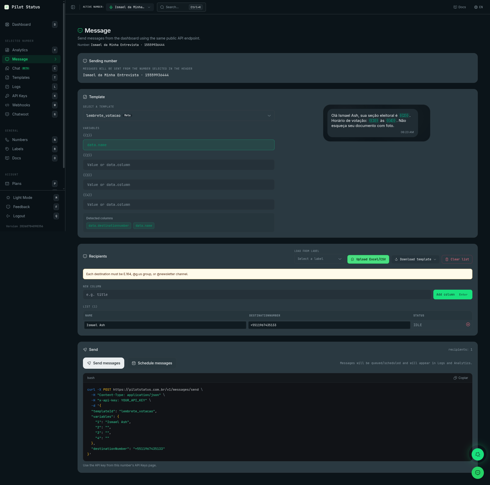

A tela **Mensagem** (`/messages`) envia um template aprovado pelo painel, para uma pessoa ou para uma lista inteira. Cada destinatário vira um envio pelo mesmo caminho do endpoint público que o seu código usa, [`POST /v1/messages/send`](/pt-BR/api/messages/send), então um envio feito daqui se comporta exatamente como um envio pela API: passa pela fila e aparece em [Logs e Análises](/pt-BR/dashboard/logs-analytics).

O envio é feito com a API key mais recente do número selecionado, então valem as configurações dessa chave (como o webhook e a retenção de dados). Se o número ainda não tem API key, uma **Default API Key** é criada para ele no primeiro envio.

<Frame caption="A página Mensagem — seletor e preview do template, variáveis ligadas a colunas da planilha, lista de destinatários com upload de Excel/CSV, ações Enviar e Agendar, e o curl gerado da chamada exata à API.">
  
</Frame>

## Como chegar

Na barra lateral, clique em **Mensagem**, no grupo **Numero selecionado** (atalho de teclado: `E`). O título da página é **Mensagem**, com o subtítulo **Envie mensagens pela dashboard usando o mesmo endpoint público da API.** e o **Número:** pelo qual você está enviando.

## Quem pode usar

**Owner**, **Admin** e **Agent** abrem a tela e enviam (permissões `messages:bulk_send` e `messages:send`). O **Analyst** não a vê. Um membro restrito a alguns números só envia por esses números. Veja [Papéis e permissões](/pt-BR/concepts/roles-and-permissions).

A tela em si não tem bloqueio por plano. Cada destinatário é uma mensagem e conta na cota de mensagens do seu plano; uma mensagem acima da cota falha com `PLAN_LIMIT_REACHED` (veja [Códigos de erro dos logs](/pt-BR/api/messages/log-error-codes)).

## O que você vê

A tela tem cinco blocos, de cima para baixo.

### Número de envio

As mensagens saem pelo número selecionado no cabeçalho (**Mensagens serão enviadas pelo número selecionado no topo**). Para enviar por outro número, troque-o no seletor de número do cabeçalho. Sem número selecionado, o bloco diz **Selecione um número no cabeçalho**.

<Note>
  Não dá para enviar pelo número de teste do Pilot Status. Se ele for o número selecionado, o envio fica bloqueado com **Número de teste: selecione um número seu para enviar mensagens.**
</Note>

### Template

Escolha o template em **Selecione um template** (com busca). A tela envia **só templates** — não há envio de texto livre nem de mídia avulsa aqui; para isso, use o [Live Chat](/pt-BR/dashboard/live-chat) ou a API.

- Num número **oficial (Meta Cloud API)**, a lista mostra só os templates desse número **aprovados pela Meta**. Um template ainda não aprovado falha com **Template ainda não aprovado pela Meta. Submeta o template para aprovação em /templates e aguarde a Meta aprovar antes de enviar por este número.**
- Os templates que vieram da Meta têm o selo **Meta** na lista.
- Nos outros números, a lista mostra todos os seus templates.

Os templates são criados e editados na tela **Templates**. Veja [Templates](/pt-BR/concepts/templates).

### Variáveis

Se o template tem variáveis, cada uma ganha um campo (**Valor ou data.coluna**). Você pode digitar:

- um valor fixo, igual para todos os destinatários; ou
- `data.<coluna>`, para pegar o valor daquela coluna da lista de destinatários (por exemplo `data.link`).

Quando uma coluna tem o mesmo nome de uma variável, o campo é preenchido com `data.<coluna>` sozinho. **Colunas detectadas** lista cada coluna da lista como um chip `data.` — clique num deles para copiar. Um template sem variáveis diz **Este template não tem variáveis.**

Nos templates de **Marketing** criados no Pilot Status, aparece a chave **Reescrever com IA (anti-spam)**: depois de montar o template, a IA varia o texto final mantendo tamanho e tom semelhantes, para que envios em massa pareçam menos repetitivos. Ela vem desligada e volta a desligar quando você troca de template. Não aparece nos templates de Marketing que vieram da Meta.

**Preview da mensagem** mostra a mensagem renderizada — cabeçalho, mídia, corpo, rodapé, botões e listas — com as variáveis preenchidas a partir do **primeiro** destinatário da lista.

### Destinatários

Monte a lista combinando estas formas. Adicionar nunca cria duplicados: um destino que já está na lista é pulado.

- **Carregar de label** — escolha uma label (cada uma mostra quantos contatos tem) para adicionar todos os contatos dela. As labels são gerenciadas na tela [Labels](/pt-BR/dashboard/labels).
- **Carregar Excel/CSV** — um arquivo `.xlsx`, `.xls` ou `.csv` com uma coluna `name` e uma coluna de destino. A coluna de destino pode se chamar `destinationNumber`, `number`, `numero`, `telefone` ou `phone`. Cada outra coluna vira uma coluna `data.` para as variáveis.
- **Baixar modelo** — baixa um modelo de planilha (**Excel (.xlsx)** ou **CSV (.csv)**) com as colunas `name`, `destinationNumber` e uma coluna por variável do template, já preenchido com o seu nome e telefone e com o número do Pilot Status.
- **Nova coluna** / **Adicionar coluna** (ou `Enter`) — adiciona uma coluna vazia em todas as linhas, para preencher à mão. Cada coluna extra tem **Remover coluna**.
- **Limpar lista** — esvazia a lista.

Ao abrir a tela, a lista começa com uma linha: o telefone do seu perfil, para que um primeiro envio vá para você.

A tabela **Lista**, com a contagem de linhas, mostra **Nome**, **destinationNumber**, cada coluna extra e **Status**. Toda célula é editável e toda linha pode ser removida. Um destino pode ser:

- um telefone no formato E.164 (`+5511999999999`);
- um grupo de WhatsApp (terminando em `@g.us`);
- um canal de WhatsApp (terminando em `@newsletter`).

Um destino inválido deixa a linha vermelha com a dica **E.164 / @g.us / @newsletter**, e um repetido é marcado **Duplicado**. Enquanto houver algum, o envio fica bloqueado.

### Enviar

O bloco mostra quantos **destinatários** estão na lista.

- **Enviar mensagens** — envia agora.
- **Agendar mensagens** — abre um seletor com data, **Hora** e **Minuto** (no fuso do seu navegador), que começa na data e hora atuais, depois **Agendar**. **Limpar** apaga a data.

Nenhum dos dois botões envia na hora. Antes abre uma confirmação — **Enviar N mensagens agora?** ou **Agendar N mensagens?** — que diz quantos destinatários recebem qual template, a data e hora da entrega quando é agendamento, e que o lote sai por esta aba do navegador: **Mantenha a aba aberta até terminar: fechar ou recarregar a página interrompe o lote no meio, e os destinatários restantes não recebem nada.** **Enviar N mensagens** (ou **Agendar N mensagens**) começa o lote, para todas as linhas da lista; **Cancelar** não envia nada.

O envio roda no seu navegador: esta aba envia cada destinatário numa requisição própria, três de cada vez, e atualiza o **Status** de cada linha: `SENDING`, depois `QUEUED` (aceita, com o ID da mensagem) ou `FAILED` com o erro embaixo. Enquanto isso, a lista e os botões ficam travados e o botão mostra **Enviando...**.

<Note>
  Mantenha esta aba aberta até o fim, ou seja, até nenhuma linha estar em `SENDING`. Fechar ou recarregar a aba interrompe o envio: os destinatários que já estavam em `QUEUED` continuam saindo, o resto nunca é enviado. Ir para outra tela esconde o resultado de cada linha. Enquanto o lote roda, o navegador pede confirmação antes de fechar ou recarregar a aba.
</Note>

No fim, uma mensagem diz quantas foram enfileiradas ou agendadas e quantas falharam.

`QUEUED` quer dizer que a mensagem entrou na fila, não que foi entregue. Entrega, leitura e falha aparecem em [Logs](/pt-BR/dashboard/logs-analytics), onde você também cancela um envio agendado ou reenvia um com falha. Nos números conectados via web, os envios frios (janela de 24h fechada) são espaçados pelo motor anti-bloqueio, então uma lista grande demora para sair.

### O curl da mesma chamada

Abaixo do bloco de envio, um **curl** mostra a requisição `POST /v1/messages/send` exata do **primeiro** destinatário, com o template escolhido e as variáveis resolvidas. Enquanto o seletor de **Agendar mensagens** está aberto, ele também leva a data e hora escolhidas como `deliverAt`; fechar o seletor sem agendar tira o campo de novo, e o comando copiado volta a ser um envio imediato. Copie para reproduzir o envio no seu código. Troque `SUA_API_KEY` pela chave da página **API Keys** deste número (**Use a API key da página API Keys deste número.**).

## Fazer pela API / MCP

| Ação no painel | API (`/v1`) | Ferramenta MCP |
| --- | --- | --- |
| Enviar um template para um destinatário | [`POST /v1/messages/send`](/pt-BR/api/messages/send) com `templateId`, `variables` e um destino (`destinationNumber`, `groupId` ou `newsletterId`) | `messages_send` |
| Enviar para uma lista | Um `POST /v1/messages/send` por destinatário — não há endpoint de envio em massa | `messages_send`, uma vez por destinatário |
| **Agendar mensagens** | O campo `deliverAt` (e, opcionalmente, `deliverUntil`) | `messages_send` com `deliverAt` |
| **Reescrever com IA (anti-spam)** | `marketingOptions.aiRewriteEnabled: true` | `messages_send` com `marketingOptions` |
| Marcar os destinatários com labels | O campo `labels` — veja [Labels](/pt-BR/api/labels) | `messages_send` com `labels` |
| Carregar destinatários de uma label | — | Só no painel |

Use uma API key do número — veja [Autenticação da API](/pt-BR/api/authentication). O passo a passo está no guia [Enviar mensagens](/pt-BR/guides/send-messages).
