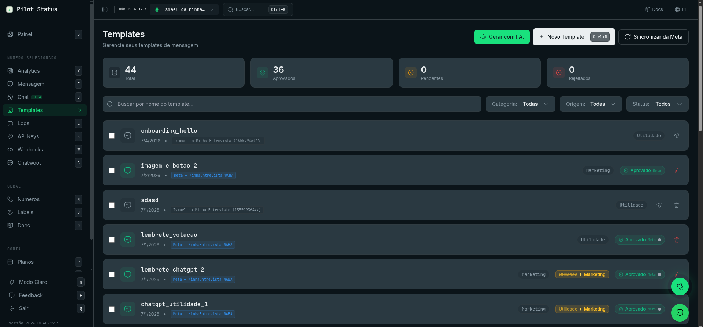
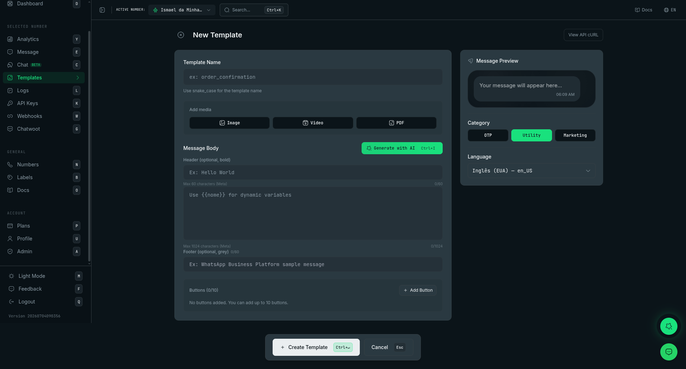

Templates são as mensagens reutilizáveis que você envia com `templateId`. Esta página descreve o que as telas do painel mostram e fazem. Para as regras do template em si — categorias, variáveis, aprovação da Meta, estrutura — veja [Templates](/pt-BR/concepts/templates) e a [API de Templates](/pt-BR/api/templates).

<Frame caption="A lista de Templates — cards de status, filtros e uma linha por template.">
  
</Frame>

## Como chegar

| Tela | Rota | Como chegar |
| --- | --- | --- |
| Lista de templates | `/templates` | **Templates** na barra lateral (atalho de teclado: `t`), ou busque "Templates" na paleta de comandos |
| Novo template | `/templates/new` | **Novo Template** na lista, `Ctrl+Shift+1` (`⌘+Shift+1` no Mac), ou "Criar Template" na paleta de comandos |
| Editar template | `/templates/:id/edit` | Clique numa linha da lista |

A lista mostra os templates do número selecionado no cabeçalho do painel. Quando o número selecionado é o número de teste da Pilot Status, a lista mostra todos os templates do workspace — mas esse número serve só para testar: excluir, sincronizar, enviar para a Meta e salvar ficam bloqueados, com a mensagem _"Número de teste: selecione um número seu para gerenciar templates."_ Escolha um número seu no cabeçalho para gerenciar templates.

## Quem pode fazer o quê

| Ação | Proprietário | Administrador | Atendente | Analista |
| --- | --- | --- | --- | --- |
| Ver a lista, os filtros e os cards de status | ✓ | ✓ | ✓ | ✓ |
| Abrir **Insights do template** | ✓ | ✓ | ✓ | ✓ |
| Copiar o nome de um template | ✓ | ✓ | ✓ | ✓ |
| Criar, editar (abrir o editor), **Gerar com I.A.** | ✓ | ✓ | — | — |
| **Sincronizar da Meta**, **Enviar para Meta**, envio de teste, excluir, ações em lote | ✓ | ✓ | — | — |

Atendente e Analista leem a lista (permissão `templates:read`). Tudo o que grava — inclusive o envio de teste, que é uma mensagem real — exige `templates:manage`, que Proprietário e Administrador têm. Para Atendente e Analista as linhas não são clicáveis e os botões de escrita e as caixas de seleção não aparecem.

Não há bloqueio por plano nestas telas.

## Lista de templates (`/templates`)

### Botões do topo

- **Gerar com I.A.** — abre o modal **Gerar Template com I.A.** (veja "Geração com I.A." abaixo). Aparece só quando a I.A. está disponível na plataforma.
- **Novo Template** — abre `/templates/new`.
- **Sincronizar da Meta** — aparece quando o workspace tem pelo menos um número oficial (Meta). Veja [Sincronizar da Meta](#sincronizar-da-meta).

### Cards de status

Quatro cards: **Total**, **Aprovados**, **Pendentes**, **Rejeitados**. Eles contam os templates carregados com os filtros ativos — não são totais do workspace inteiro. **Rejeitados** soma os rejeitados e os desabilitados. Clicar num card aplica o filtro de **Status** (**Total** limpa o filtro).

### Filtros

- **Buscar por nome do template...** — filtra pelo nome enquanto você digita.
- **Categoria:** **Todas**, **OTP**, **Marketing**, **Utilidade**. Ao passar o mouse numa opção, você vê para que serve a categoria, exemplos e a regra que vale no número da Pilot Status.
- **Origem:** **Todas**, **Pilot Status** (templates que não estão na Meta: rascunhos nunca enviados e templates de números que não são Meta), **Meta** (templates na sua conta do WhatsApp Business — importados por **Sincronizar da Meta** ou enviados pela Pilot Status; o template passa para cá assim que a Meta aceita o envio).
- **Status:** **Todos**, **Aprovado**, **Pendente**, **Rejeitado**, **Desabilitado**, **Pausado** (status de revisão da Meta).

A lista mostra 20 templates por vez; **Carregar mais** mostra os próximos 20. Ela se atualiza quando você volta para a aba. Sem resultados, aparece _"Nenhum template encontrado"_.

### O que cada linha mostra

- O **nome** do template (em fonte monoespaçada) e um ícone que copia o nome para a área de transferência.
- A data da última atualização.
- Um selo **Meta** (com o nome da WABA, `Meta — <nome da WABA>`) quando o template está na Meta, ou o número ao qual o template pertence.
- A **categoria**. Quando a Meta mudou a categoria na revisão, um selo mostra a categoria antiga riscada e a nova (dica: _"Categoria alterada pela Meta"_).
- O selo de **status na Meta** — **Aprovado**, **Pendente**, **Rejeitado**, **Desabilitado** ou **Pausado** — com uma bolinha colorida da nota de qualidade da Meta (verde, amarela, vermelha) quando a Meta informa uma.
- Num template rejeitado, **Motivo:** seguido do motivo da rejeição dado pela Meta.

### Ações da linha

Passe o mouse sobre a linha para ver os ícones de ação. Quais aparecem depende do template e do seu papel:

| Ícone (dica) | Quando aparece | O que faz |
| --- | --- | --- |
| Gráfico (**Insights do template**) | O template está na Meta e a WABA dele não é uma conta do WhatsApp Business App / coexistência | Abre o modal [Insights do template](#insights-do-template) |
| Frasco (**Testar template**) | O template ainda não está na Meta, número de teste da Pilot Status conectado, Proprietário/Administrador | Abre o modal **Enviar Teste** |
| Enviar (**Enviar para aprovação na Meta** / **Re-enviar para aprovação na Meta**) | O template ainda não está na Meta, o workspace tem número Meta, Proprietário/Administrador | Abre o modal [Enviar para Meta](#enviar-para-meta) |
| Lixeira | O template nunca esteve na Meta, Proprietário/Administrador | Exclui o template ([Excluir Template](#excluir)) |
| Lixeira vermelha (**Excluir template da Meta**) | O template está na Meta, Proprietário/Administrador | Exclui na Meta e na Pilot Status ([Excluir Template da Meta](#excluir)) |

Clicar em qualquer outro ponto da linha abre o editor (Proprietário/Administrador).

Depois que a Meta aceita o envio, o template passa a contar como template da Meta: os ícones de envio e de frasco somem da linha dele, e as alterações seguintes passam pelo **Salvar** do editor (veja [Editar e reenviar](#editar-e-reenviar)).

### Ações em lote

Proprietário e Administrador veem uma caixa de seleção em cada linha. Ao marcar pelo menos uma, aparece uma barra com:

- **Excluir selecionados** — pede confirmação no modal **Excluir Templates** e exclui cada um. Templates que estão na Meta são excluídos na Meta também.
- **Enviar selecionados para Meta** — abre a confirmação de [Enviar para Meta](#enviar-para-meta) e envia cada template selecionado para o número Meta selecionado no cabeçalho. Templates que já estão na Meta são ignorados.
- **Desmarcar todos**.

## Sincronizar da Meta

**Sincronizar da Meta** importa para a Pilot Status os templates que existem nas suas contas do WhatsApp Business, de **todos** os números Meta do workspace (não só o do cabeçalho). Templates novos são criados e os existentes são atualizados. O resultado aparece numa notificação — _"Sincronizado da Meta: 2 novo(s), 3 atualizado(s)"_ — ou _"Nenhum template novo encontrado na Meta."_

Se não for possível acessar uma conta na Meta, aparece: _"Não foi possível acessar a conta WhatsApp Business (WABA) na Meta. Ela pode ter sido removida/excluída, ou o System Token não tem permissão. Reconecte o número na Meta."_

## Excluir

Há dois caminhos de exclusão, e qual a linha oferece depende de o template estar ou não na Meta.

- **Excluir Template** (ícone de lixeira comum) — para um template que nunca foi enviado à Meta. O modal pergunta _"Tem certeza que deseja excluir o template"_ com o nome. Em caso de sucesso: _"Template excluído!"_
- **Excluir Template da Meta** (ícone de lixeira vermelho) — para um template que está na Meta. O modal diz _"Tem certeza que deseja excluir este template da Meta? Esta ação não pode ser desfeita."_ Ele exclui o template na Meta **e** na Pilot Status. Em caso de sucesso: _"Template excluído da Meta!"_

<Warning>
  Excluir um template na Meta não pode ser desfeito.
</Warning>

### Quando a Meta recusa a exclusão

Se a Meta recusar (por exemplo, o token não tem permissão na WABA), nada é excluído e abre o modal **A Meta recusou a exclusão**. Ele mostra o motivo dado pela Meta e o nome do template, e explica que você pode remover apenas a cópia da Pilot Status — o template **continua** na Meta e pode reaparecer na próxima sincronização. **Remover só a cópia local** faz isso, e a notificação confirma: _"Removido só do Pilot Status. O template CONTINUA na Meta e pode reaparecer na próxima sincronização."_ Essa opção só aparece depois de uma recusa; nunca é o caminho padrão.

Se a Meta disser que o template não existe lá, aparece _"Este template não foi encontrado na Meta. Tente excluí-lo apenas localmente."_

## Insights do template

O modal **Insights do template** mostra as métricas da Meta para um template que está na Meta:

- O nome do template, o status na Meta e a nota de qualidade (**GREEN**, **YELLOW**, **RED**).
- Um seletor de período: **7 dias**, **30 dias** (padrão), **90 dias**.
- Quatro números: **Enviadas**, **Entregues**, **Lidas**, **Taxa de leitura** (— quando nada foi entregue).
- **Enviadas por dia** — uma barra por dia.
- **Cliques no botão** — cada botão com o número de cliques, ou _"Nenhum clique registrado no período."_

Se a Meta recusar (por exemplo, a conta é do WhatsApp Business App / coexistência, onde a Meta não oferece insights), o modal mostra o motivo e um botão **Tentar novamente**; no caso da coexistência, o ícone de gráfico some dos templates daquela conta. Insights são só leitura — todos os papéis podem abrir.

## Editor (`/templates/new` e `/templates/:id/edit`)

<Frame caption="O editor de templates — formulário à esquerda, preview ao vivo e categoria/idioma à direita.">
  
</Frame>

O editor tem o formulário à esquerda e uma coluna lateral à direita. O título da página é **Novo Template** ou **Editar Template**. Na edição, a área do título mostra também o nome do template, o selo de status e, num template rejeitado, **Motivo:** com o motivo da Meta e _"Veja o WhatsApp Manager para mais detalhes."_ O botão **Ver cURL da API** fica no canto superior direito.

### Formulário

- **Nome do Template** (só na criação) — convertido para snake_case enquanto você digita. Se o nome já existe, aparece _"Já existe um template com esse nome."_ O nome não pode ser alterado depois de criado.
- **Adicionar mídia** — mídia do cabeçalho: **Imagem**, **Vídeo** ou **PDF**. Escolha **Enviar por URL** para colar um link `http(s)` direto, ou **Upload** para enviar um arquivo (**Escolher imagem**, **Escolher vídeo MP4**, **Escolher PDF**). Limites: PNG, JPEG, WebP ou GIF até 5 MB; MP4 até 16 MB; PDF até 10 MB. Depois do upload aparece **Mídia no servidor** e _"Lembre-se de clicar em 'Salvar' para persistir esta mídia no template."_ — o upload só fica gravado quando você salva. A mídia fica indisponível enquanto houver cabeçalho de texto, lista ou carrossel. **Remover mídia** limpa a mídia.
- **Corpo da Mensagem** — três campos, com `{{variavel}}` destacado:
  - **Cabeçalho (opcional, negrito)** — máx. 60 caracteres, no máximo 1 variável, sem emojis, quebras de linha ou formatação. Indisponível enquanto houver mídia no cabeçalho, lista ou carrossel.
  - O corpo — máx. 1024 caracteres (com contador).
  - **Rodapé (opcional, cinza)** — máx. 60 caracteres.
- **Variáveis detectadas** — cada `{{variavel}}` encontrada, como etiquetas.
- **Exemplos das variáveis** — um valor de exemplo por variável, enviado à Meta para aprovação. **Gerar exemplos com I.A.** preenche esses valores (quando a I.A. está disponível).
- **Botões** — a lista de botões (até 10) com **Adicionar Botão**, que abre o modal de botões (veja "Modal Adicionar Botão" abaixo). Clique num botão para editá-lo; a lixeira o remove.
- **Carrossel** — **Adicionar carrossel** transforma o template num carrossel de 2 a 10 cards, cada um com uma imagem, um texto curto e até 2 botões. Ele é exclusivo: com carrossel não há cabeçalho nem seção de botões, e **Adicionar carrossel** some quando o template já tem botões, lista ou card de pedido.

Num número oficial (Meta) com categoria **OTP**, o formulário passa para o layout fixo de autenticação da Meta: você vê o texto fixo, um botão **Copiar código**, a chave **Recomendação de segurança** (acrescenta a frase "não o compartilhe") e **Expiração do código (min)** (opcional, de 1 a 90). Corpo, cabeçalho, rodapé e botões não são editáveis ali.

### Coluna lateral

- **Preview da Mensagem** — um preview ao vivo, no estilo do WhatsApp, da mensagem enquanto você digita, com os exemplos das variáveis aplicados, mídia, botões, lista, card de pedido ou carrossel. Quando o template tem um link, uma nota recomenda encurtá-lo com a ShareContent.
- **Categoria** — **OTP**, **Utilidade** ou **Marketing**, com uma dica em cada uma. Definida na criação; na edição fica só leitura (_"A categoria não pode ser alterada após a criação."_). Num template aprovado: _"Template aprovado — alterações exigem nova aprovação da Meta."_; num pendente: _"Template pendente — alterações podem afetar a aprovação."_
- **Idioma** — lista pesquisável dos idiomas da Meta. Também fixo depois da criação.

### Barra inferior

- **Criar Template** (criação) ou **Salvar** (edição). Desabilitado enquanto o número de teste da Pilot Status está selecionado (_"Número de teste: selecione um número seu para salvar ou publicar templates."_).
- **Enviar para Meta** (só na edição) — aparece para templates que ainda não estão na Meta, quando o workspace tem número Meta. Salva primeiro (ou, sem alterações, segue direto) e depois abre a confirmação de [Enviar para Meta](#enviar-para-meta).
- **Enviar Teste** — aparece quando o número de teste da Pilot Status está conectado. Abre o modal **Enviar Teste**.
- **Cancelar** (`Esc`).

### Editar e reenviar

O que o **Salvar** faz depende de o template já estar na Meta ou não. Nome, categoria e idioma nunca mudam depois da criação, seja qual for o estado.

- **Ainda não está na Meta** (um rascunho, ou um template de um número que não é Meta) — **Salvar** só grava a alteração na Pilot Status. Envie para revisão com **Enviar para Meta**.
- **Está na Meta** (enviado pela Pilot Status ou importado por **Sincronizar da Meta**) — **Salvar** envia a versão editada para a Meta como edição do mesmo template. A Pilot Status só grava a versão nova depois que a Meta a aceita; o status volta para **Pendente** até a Meta revisar de novo. Se a Meta recusar, nada muda — nem na Pilot Status, nem na Meta.

É assim que se corrige um template **rejeitado**: abra-o pela lista, leia o **Motivo:** ao lado do status, corrija o conteúdo e clique em **Salvar**. Não existe um botão separado de reenvio para um template que já está na Meta — salvar é o reenvio.

A Meta só aceita edição de templates em certos estados. Um template **aprovado** é recusado, e você vê _"A Meta não permite editar este template no estado atual (só templates rejeitados podem ser editados). Crie um novo template com a alteração ou envie o documento no momento do envio."_ A versão aprovada continua como estava, na Pilot Status e na Meta; crie um template novo com a alteração. Para templates **Pausados** e **Desabilitados** a Meta decide da mesma forma; quando ela recusa por um motivo que a Pilot Status não traduz, aparece _"Falha ao salvar template"_ e nada muda.

Se nada mudou, aparece _"Nenhuma mudança detectada no template."_ Depois de salvar com sucesso você volta para a lista.

### Templates com botão de Flow

Um template cuja versão gravada tem um botão de **Flow** — seja porque você o adicionou pelo [seletor de Flow](#seletor-de-flow), seja porque ele veio da Meta — fica somente leitura no editor, assim como um com botão de catálogo ou do WhatsApp Pay criado no painel da Meta. Você consegue abri-lo e até abrir o botão, mas **Salvar** é recusado com _"Este template tem um botão que o Pilot Status ainda não suporta (FLOW). Salvar aqui apagaria esse botão na Meta. Edite-o no painel da Meta."_ — salvar recriaria o template na Meta sem esse botão. A mesma mensagem aparece em **Enviar para Meta** na barra inferior do editor, porque ele salva antes.

- Para enviar à Meta um rascunho que tem botão de Flow, use o ícone de envio na linha dele na lista (ou **Enviar selecionados para Meta**), que envia sem salvar.
- Para mudar o texto do template ou o Flow dele, crie um template novo. Pela API, `PUT /v1/templates/{id}` só aceita a edição se o botão de Flow continuar vinculado ao mesmo Flow.

## Modal Adicionar Botão

**Adicionar Botão** abre o modal **Adicionar Botão** (**Editar Botão** quando você clica num botão existente): _"Escolha o tipo de botão que deseja adicionar."_

| Opção | O que adiciona |
| --- | --- |
| **Botão de Resposta** | Uma resposta rápida com texto predefinido |
| **Botão de Ação** | **Tipo de Ação**: **Abrir Site (URL)**, **Ligar (Telefone)** ou **Copiar**; mais **Texto do Botão**. Uma URL pode terminar com uma variável depois de uma base fixa |
| **Botão de Lista** | Uma lista interativa: até 10 seções e 10 opções no total, cada opção com título, descrição opcional e ID opcional (que volta na resposta). A lista é exclusiva — nenhum outro botão nem card de pedido |
| **Botão de Pagamento** | **Formato do pagamento**: **Pix** (um botão que copia o código Pix copia-e-cola, ou uma `{{variavel}}`) ou **Card de pedido** (itens, quantidades, preços, número do pedido e **Forma de pagamento**: **Pix**, **Boleto**, **Link de pagamento**, **Cartão**) |
| **Flow** | Um botão que abre um Flow do WhatsApp dentro da conversa |

As opções que a combinação atual não permite ficam desabilitadas, com o motivo (limite de botões atingido, exclusividade da lista).

### Seletor de Flow

A opção **Flow** está sempre visível. Ela fica desabilitada com _"Só em número da API Oficial (Meta Cloud API)."_ num número que não é Meta, e com _"Já há um Flow neste template — a Meta aceita um por template."_ quando já existe um. O passo pede:

- **Texto do botão** (até 25 caracteres).
- **Flow** — a lista de todos os Flows da conta do WhatsApp Business do número, cada um com o seu estado (**Selecione um Flow**). Se você escolher um que não está publicado, o aviso diz que o template pode ser aprovado assim, mas o botão só abre depois de o Flow ser publicado. Sem Flows: _"Nenhum Flow nesta conta. Crie um no Gerenciador da Meta e sincronize antes de vincular."_ Se a lista não carregar, a mensagem diz isso — não significa que não existam Flows.
- **Ação** — **Abrir uma tela** (com **Tela inicial**) ou **Trocar dados com o endpoint**.

Escolha o Flow antes de salvar o template: depois que o template é criado, o botão de Flow dele não pode mais ser alterado pelo editor (veja [acima](#templates-com-botão-de-flow)). Veja [A tela de Flows](/pt-BR/dashboard/flows) e a [API de Flows](/pt-BR/api/flows) para criar e publicar Flows.

## Geração com I.A.

**Gerar com I.A.** (na lista, e ao lado de **Corpo da Mensagem** no editor de novo template; atalho `Ctrl+I` / `⌘+I`) abre **Gerar Template com I.A.**: _"Descreva o objetivo do seu template. A I.A. vai criar o nome, o texto da mensagem e até sugerir botões se achar necessário."_ Escreva o briefing e clique em **Gerar**. A partir da lista, ele abre `/templates/new` e começa a gerar na hora.

Durante a geração aparece _"I.A. trabalhando..."_ — ela preenche categoria, nome, corpo, cabeçalho, rodapé, botões, idioma e os exemplos das variáveis. Se um campo gerado passar do limite da Meta, a I.A. é chamada de novo para encurtá-lo automaticamente, e uma notificação diz quais campos foram encurtados (_"Encurtei para caber no limite da Meta: …"_). Se um campo ainda não couber, um aviso informa o tamanho e o máximo para você ajustar antes de salvar — o texto nunca é cortado em silêncio.

A geração com I.A. existe só em templates novos; na edição, só **Gerar exemplos com I.A.** é oferecido. Os pontos de entrada da I.A. ficam escondidos quando a I.A. não está disponível na plataforma.

## Enviar Teste

O modal **Enviar Teste** envia uma mensagem real para você ver o template no WhatsApp. Ele precisa do número de teste da Pilot Status conectado (senão: _"O número padrão da Pilot Status está desconectado. Conecte a instância para enviar teste."_).

- _"A mensagem será enviada para o número configurado no seu perfil."_
- **Preencha as variáveis:** um campo por variável. _"Campos vazios são enviados como string vazia ("") na API."_
- **Enviar Teste** envia. No editor, dá para testar um template que ainda não foi salvo.

Depois do envio, o modal acompanha a mensagem: **Teste em fila** → **Teste enviado** → **Teste entregue** → **Teste lido**, ou **Falha no teste** com o motivo. Ele mostra também **Requisição equivalente (cURL):** — a chamada `POST /v1/messages/send` que envia este template, com um botão **Copiar**. **Enviar outro teste** reinicia o formulário.

Um teste com mídia de vídeo ou PDF não pode ter botões (_"Remova todos os botões antes de enviar teste com vídeo ou PDF."_), e é preciso esperar o upload da mídia terminar.

## Ver cURL da API

**Ver cURL da API**, no editor, abre **Enviar este template pela API**: um `curl` pronto para copiar de `POST /v1/messages/send` com:

- `templateId` preenchido com o **nome** do template,
- um `destinationNumber` de exemplo (`+5511999999999`),
- um marcador `<variavel>` por variável,
- `media` e `mediaType` quando o template tem mídia no cabeçalho.

A chave no comando é o marcador `ps_sua_chave_aqui` — o modal nunca mostra a sua API Key real. Troque pela chave do número na página **API Keys**, e troque os marcadores e o `destinationNumber` por valores reais. Num template novo ainda sem nome, ele avisa: _"Salve o template primeiro para obter o ID definitivo (templateId)."_

## Enviar para Meta

Enviar para a Meta submete à revisão da Meta um template criado na Pilot Status. Ele sempre vai para o **número Meta selecionado no cabeçalho** — se o cabeçalho estiver num número que não é Meta, aparece _"Selecione um número Meta no header."_

O modal **Enviar para Meta** pergunta _"Confirmar envio do template para &lt;nome do número&gt; (&lt;número&gt;)?"_ com o nome do template, e **Enviar** / **Cancelar**.

Você chega nele por:

- o ícone de envio numa linha (**Enviar para aprovação na Meta**, ou **Re-enviar para aprovação na Meta** se ele já foi enviado antes),
- **Enviar selecionados para Meta** na barra de ações em lote,
- **Enviar para Meta** na barra inferior do editor (salva antes),
- logo depois de **Criar Template** num número Meta: um aviso **Template criado!** / **Enviar para Meta?** com **Sim** (abre a confirmação) e **Depois** (mantém como rascunho e volta para a lista).

Templates com **Botão de Lista** não podem ser enviados para a Meta: num número oficial eles saem como mensagem interativa, só dentro da janela de atendimento de 24 horas. Templates que já estão na Meta não mostram esta ação — para reenviar um rejeitado, edite-o e clique em **Salvar** (veja [Editar e reenviar](#editar-e-reenviar)).

Depois do envio, o template está na Meta e o status fica **Pendente** até a Meta revisar; a Meta também pode mudar a categoria (a linha mostra _"Categoria alterada pela Meta"_). Use **Sincronizar da Meta** ou reabra a lista para ver o resultado. Veja [Templates](/pt-BR/concepts/templates) e os erros de envio e rejeição na [API de Templates](/pt-BR/api/templates).

## Valores nestas telas

Nada nestas telas é mostrado uma vez só, e nenhum segredo é exibido: os comandos cURL usam uma API Key de marcador. Todo o resto — nome do template, status, motivo da rejeição, qualidade, insights — pode ser lido de novo a qualquer momento na lista, no editor ou pela API.

## Pela API / MCP

| Ação no painel | REST (`/v1`) | Ferramenta MCP |
| --- | --- | --- |
| Listar templates | `GET /v1/templates` | `templates_list` |
| Abrir um template | `GET /v1/templates/{id}` | `templates_get` |
| Criar um template | `POST /v1/templates` — num número Meta ele é enviado para a Meta na criação | `templates_create` |
| Editar (Salvar) | `PUT /v1/templates/{id}` — reenvia para a Meta em números Meta | `templates_update` |
| Excluir / Excluir da Meta | `DELETE /v1/templates/{id}` | `templates_delete` |
| Remover só a cópia local (depois de uma recusa da Meta) | `DELETE /v1/templates/{id}?force_local=true` | `templates_delete` com `force_local_delete: true` |
| Insights do template | `GET /v1/templates/{id}/insights` (`days`: 7, 30 ou 90) | `templates_insights` |
| Enviar o template (o que o cURL mostra) | `POST /v1/messages/send` | `messages_send` |
| Listar Flows para o seletor de Flow | `GET /v1/flows` | `flows_list` |

Só no painel: **Sincronizar da Meta**, enviar à Meta separadamente um rascunho já existente, **Enviar Teste**, **Gerar com I.A.** / **Gerar exemplos com I.A.**, o **Upload** de mídia (a API recebe a mídia do cabeçalho por URL) e as ações em lote.

A API exige uma API Key com escopo de número. Veja [API de Templates](/pt-BR/api/templates), [Enviar mensagem](/pt-BR/api/messages/send) e [Servidor MCP](/pt-BR/integrations/mcp-server).
