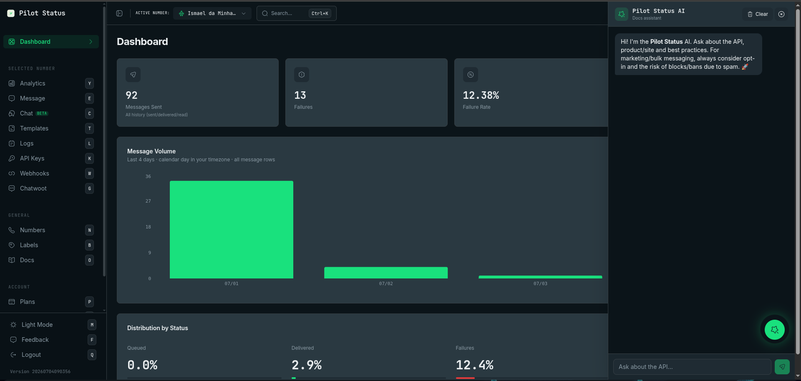

Não há nenhum prompt de copiar/colar para manter. Para ensinar a uma IA tudo sobre o Pilot Status, aponte-a para as fontes canônicas legíveis por máquina.

<Frame caption="O assistente de IA do Pilot Status dentro do painel — pergunte sobre a API, o produto e boas práticas.">
  
</Frame>

## Comece aqui: o guia de integração

Para levar um usuário do zero a uma integração funcionando — credencial, conexão MCP, primeira mensagem, webhook com o segredo de assinatura, verificação da assinatura, verify token da Meta, templates e erros — siga [Integrar a Pilot Status com IA](/pt-BR/guides/integrate-with-ai). Cada passo diz onde cada valor aparece, então nada exige falar com o suporte.

## llms.txt

O índice legível por máquina desta documentação é gerado a partir de todas as páginas e fica sempre atualizado:

```text
https://docs.pilotstatus.com.br/llms.txt
https://docs.pilotstatus.com.br/llms-full.txt
```

O `llms.txt` indexa endpoints, schemas de webhook, conceitos e códigos de erro, com um link por página (cada página também é servida em Markdown acrescentando `.md` à URL). Quando ele fica grande, grupos de páginas vão para subíndices em `/_llms/` — siga esses links até chegar às páginas. O `llms-full.txt` é o texto completo de todas as páginas num arquivo só. Cole qualquer uma das URLs no seu agente de código ou ferramenta de LLM e ele lê só o que precisa, em vez de um prompt gigante.

<Tip>
  Ao pedir a um assistente de código para construir uma integração com o Pilot Status, forneça primeiro a URL do `llms.txt`. Ele vai extrair os formatos exatos de request/response (por exemplo, os três modos de `POST /v1/messages/send`) em vez de alucinar endpoints.
</Tip>

<Note>
  `https://pilotstatus.com.br/llms.txt` serve uma cópia periódica do `llms-full.txt` e pode ficar atrasada. Prefira as URLs de `docs.pilotstatus.com.br` acima.
</Note>

## Credenciais que só o painel mostra

Alguns valores são exibidos ao usuário **uma única vez**, ou só no painel, e nenhuma página da documentação ou endpoint de leitura os devolve. Um assistente que ajuda um usuário a integrar deve dizer **onde procurar** — nenhum deles exige falar com o suporte:

| Credencial | Onde o usuário encontra | Perdeu? |
| --- | --- | --- |
| **Segredo de assinatura do webhook de número** | Exibido uma vez: na janela **Segredo de assinatura**, logo depois de criar o webhook em **Webhooks** (`/webhooks`), ou no campo `secret` da resposta do `POST /v1/webhooks`. | Gere outro: **Editar Webhook → Gerar novo segredo**, ou `POST /v1/webhooks/{id}/rotate-secret`. O antigo deixa de verificar na hora. Veja [Configurar webhooks](/pt-BR/api/webhooks/configure#segredo-de-assinatura-no-painel). |
| **Segredo de webhook das linhas / do workspace** (`plwh_…`) | Exibido uma vez: na janela **Segredo de assinatura**, logo depois de criar o webhook em **Linhas → Webhooks das linhas** (`/linhas/webhooks`) ou **Chaves do workspace → Webhooks** (`/workspace-api-keys`), ou na resposta do `POST`. | Não há rotação: crie um novo webhook e exclua o antigo. Veja [Webhooks das linhas](/pt-BR/api/phone-lines/webhooks#configurar). |
| **URL de Callback e Verify Token da Meta** (número conectado pela **API Meta Oficial (Cloud API)** com credenciais) | Na janela **Número Meta Criado!**, logo depois de conectar; depois, no cartão do número em **Números** (bloco de webhook). Só o **dono do workspace** pode copiar o Verify Token. | Copie de novo no cartão do número. Veja [Conectando números](/pt-BR/connecting-numbers). |
| **Chaves de API** | Exibidas uma vez, quando criadas ou regeneradas. | Regenere a chave. Veja [Tipos de chave](/pt-BR/api/key-types). |

## Servidor MCP

Para agentes que devem **agir** (enviar mensagens, ler conversas, gerenciar números) em vez de apenas ler a documentação, use o servidor oficial do Model Context Protocol — um conector hospedado em `https://mcp.pilotstatus.com.br/mcp` que expõe a API pública `/v1` como ferramentas, com autenticação via OAuth ou `x-api-key`.

- **151 ferramentas** em `/mcp`; o **Code Mode**, em `https://mcp.pilotstatus.com.br/code`, expõe as mesmas ferramentas como 2 (`describe` e `execute`) para agentes que encadeiam muitas chamadas. Veja [MCP Code Mode](/pt-BR/integrations/mcp-code-mode).
- **Ferramentas destrutivas** (`templates_delete`, `workspace_archive`, `workspace_transfer_ownership`, `workspace_members_remove`) devolvem antes uma prévia e um `confirm_token`; mostre a prévia ao usuário e chame de novo com o token só depois de um "sim" explícito. Veja [Confirmação para ferramentas destrutivas](/pt-BR/integrations/mcp-server#confirmação-para-ferramentas-destrutivas).
- **Por OAuth**, revelar ou criar chaves de API `ps_` é só do **Proprietário** do workspace (senão `403 OAUTH_SECRET_REQUIRES_OWNER`); segredos de assinatura e o verify token da Meta vão para Proprietário ou Administrador. Veja [Segredos e chaves de API por OAuth](/pt-BR/integrations/mcp-server#segredos-e-chaves-de-api-por-oauth).

Consulte [Servidor MCP](/pt-BR/integrations/mcp-server) para a lista de ferramentas e configuração, e [Agentes de IA](/pt-BR/guides/ai-agents) para padrões de bots orientados por webhook.

## Relacionados

- [Integrar a Pilot Status com IA](/pt-BR/guides/integrate-with-ai)
- [Guia de Agentes de IA](/pt-BR/guides/ai-agents)
- [Servidor MCP](/pt-BR/integrations/mcp-server)
- [SDKs & n8n](/pt-BR/integrations/sdks)