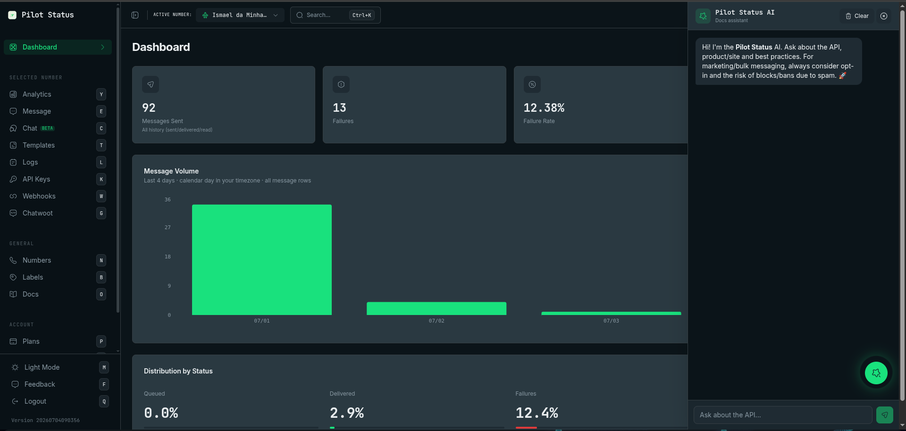

There is no copy/paste prompt to maintain. To teach an AI everything about Pilot Status, point it at the canonical machine-readable sources.

<Frame caption="The Pilot Status AI assistant inside the dashboard — ask about the API, product, and best practices.">
  
</Frame>

## llms.txt

The master reference for AI tools lives at the docs domain:

```text
https://pilotstatus.com.br/llms.txt
```

It indexes endpoints, webhook schemas, concepts, and error codes. Paste the URL into your coding agent or LLM tool and it can navigate to the deep documentation pages it needs — each topic is linked from the index, so the model reads only what is relevant instead of a giant prompt.

<Tip>
  When asking a coding assistant to build a Pilot Status integration, give it the `llms.txt` URL first. It will pull the exact request/response shapes (e.g. the three modes of `POST /v1/messages/send`) instead of hallucinating endpoints.
</Tip>

## Credentials only the dashboard shows

Some values are shown to the user **once**, or only in the dashboard, and no docs page or read endpoint returns them. An assistant helping a user integrate should tell them **where to look** — none of these requires contacting support:

| Credential | Where the user finds it | Lost it? |
| --- | --- | --- |
| **Number webhook signing secret** | Shown once: in the **Signing secret** window right after creating the webhook on **Webhooks** (`/webhooks`), or in the `secret` field of the `POST /v1/webhooks` response. | Rotate it: **Edit Webhook → Generate a new secret**, or `POST /v1/webhooks/{id}/rotate-secret`. The old one stops verifying immediately. See [Configure webhooks](/api/webhooks/configure#signing-secret-in-the-dashboard). |
| **Phone-line / workspace webhook secret** (`plwh_…`) | Shown once: in the **Signing secret** window right after creating the webhook on **Phone lines → Line webhooks** (`/linhas/webhooks`) or **Workspace keys → Webhooks** (`/workspace-api-keys`), or in the `POST` response. | No rotation: create a new webhook and delete the old one. See [Phone line webhooks](/api/phone-lines/webhooks#configure). |
| **Meta Callback URL and Verify Token** (number connected through **Official Meta API (Cloud API)** with credentials) | In the **Meta Number Created!** window right after connecting; later, on the number's card on **Numbers** (webhook block). Only the **workspace owner** can copy the Verify Token. | Copy it again from the number's card. See [Connecting numbers](/connecting-numbers). |
| **API keys** | Shown once, when created or regenerated. | Regenerate it. See [Key types](/api/key-types). |

## MCP server

For agents that should **act** (send messages, read conversations, manage numbers) rather than just read docs, use the official Model Context Protocol server — a hosted connector at `https://mcp.pilotstatus.com.br/mcp` exposing the public `/v1` API as tools, with OAuth or `x-api-key` authentication.

See [MCP Server](/integrations/mcp-server) for the tool list and setup, and [AI Agents](/guides/ai-agents) for webhook-driven bot patterns.

## Related

- [AI Agents guide](/guides/ai-agents)
- [MCP Server](/integrations/mcp-server)
- [SDKs & n8n](/integrations/sdks)